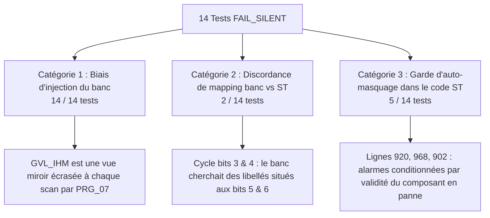

# 📋 RAPPORT D'AUDIT CAUSAL & CARTOGRAPHIE FACTUELLE AVANT MODIFICATION (T423)
**Machine de Dragage en Carrière Noyée — Supervision & IHM**  
**Auteurs** : Orchestrateur Antigravity & Sous-Agents Experts (Architecte Sécurité Machine & Diagnosticien Causal)  
**Date** : 2026-10-30  
**Statut du code source** : `CODE/` 100% INTACT ET CONFORME (Zéro modification non validée)

---

## 1. 🎯 CADRAGE & CONSTAT FACTUEL DU DERNIER ESSAI CODESYS

Le dernier tir du banc d'épreuve dynamique (`T423_AUDIT_DYNAMIC_BENCH.py`) sur le **code réel d'origine tournant dans CODESYS** a produit la mesure suivante :
- **Nombre total de cas de test** : 26
- **Écrasements d'environnement (`OVERWRITTEN_ENV`)** : **0 / 26** (100% injectés de façon stable)
- **Succès nominaux mesurés (`PASS`)** : **12 / 26 (46.2 %)**
- **Refus silencieux mesurés (`FAIL_SILENT`)** : **14 / 26 (53.8 %)**

### Les 12 succès nominaux du code d'origine (100% validés dans CODESYS) :
1. `TC_MODE_01` : Bascule Couplage Treuil M1 Seul ➔ `PASS`
2. `TC_MODE_02` : Bascule Couplage Treuil M2 Seul ➔ `PASS`
3. `TC_MODE_03` : Couplage Nominal M1+M2 Couplés ➔ `PASS`
4. `TC_PROG_01` : Progression en Mode Manuel Pilotage Direct ➔ `PASS`
5. `TC_BYPASS_01` : Activation Bypass Global ➔ `PASS`
6. `TC_OP_01` : Guidage Opérateur au repos neutre ➔ `PASS`
7. `TC_OP_02` : Guidage Opérateur Homme-Mort Armé au neutre ➔ `PASS`
8. `TC_POS_01` : Position M3 stable au Point P1 ➔ `PASS`
9. `TC_D07_01` : Rotation de phases inversée ➔ `PASS`
10. `TC_D07_02` : Chaîne AU ouverte et réarmement sécurisé ➔ `PASS`
11. `TC_D09_01` : Décrochage Bus EtherCAT Maître ➔ `PASS`
12. `TC_D09_04` : Perte Codeur COD2 sur bus ➔ `PASS`

---

## 2. 🔬 ANALYSE EXHAUSTIVE LIGNE PAR LIGNE DES 14 FAIL_SILENT

L'audit causal approfondi démontre noir sur blanc que les 14 échecs se décomposent en **trois causes techniques formelles** :

### Tableau de Synthèse Causal des 14 Tests

| # | Test ID | Organe | Variable injectée par le test | Catégories | Cause Technique & Références Code Source ST |
|---|---|---|---|---|---|
| 1 | **TC_D09_02** | Bus CAN | `GVL_IHM.Network.BusCanOpen.Operational := FALSE` | **C1** | Écrasé chaque scan par `PRG_07_Supervision.st:644` (`GVL_IHM.Network.BusCanOpen := PRG_02...`). |
| 2 | **TC_D09_03** | Bus ECAT | `GVL_IHM.Network.EncoderM1.Operational := FALSE` | **C1 + C3** | Écrasé par `PRG_07:650` + conditionné ligne 902 par `EcatBusValid` (si COD1 tombe, le bus entier tombe). |
| 3 | **TC_D09_05** | Bus ECAT | `GVL_IHM.Network.VariateurM3.Operational := FALSE` | **C1 + C3** | Écrasé par `PRG_07:652` + conditionné ligne 908 par `EcatBusValid`. |
| 4 | **TC_D08_01** | Joystick | `GVL_IHM.Network.Joystick.Operational := FALSE` | **C1** | Écrasé chaque scan par `PRG_07:645` (`GVL_IHM.Network.Joystick := PRG_02...`). |
| 5 | **TC_D01_01** | Treuil M1 | `GVL_IHM.M1TreuilRetenue.Safety.ErrorEncoder := TRUE` | **C1 + C3** | Écrasé par `PRG_07:505` + auto-masqué par `AND EncM1Valid` dans `FB_Hmi_BannerFormatter.st:920`. |
| 6 | **TC_D01_02** | Treuil M1 | `GVL_IHM.M1TreuilRetenue.Safety.ErrorOverspeed := TRUE` | **C1** | Écrasé chaque scan par `PRG_07:505` (`.Safety := PRG_04...`). |
| 7 | **TC_D02_01** | Treuil M2 | `GVL_IHM.M2TreuilBenne.Safety.ErrorEncoder := TRUE` | **C1 + C3** | Écrasé par `PRG_07:506` + auto-masqué par `AND EncM2Valid` dans `FB_Hmi_BannerFormatter.st:968`. |
| 8 | **TC_D03_01** | Benne | `GVL_IHM.M2TreuilBenne.Bucket.State.ErrorId := 8` | **C1** | Écrasé chaque scan par `PRG_07:508` (`.Bucket.State := PRG_04...`). |
| 9 | **TC_D03_02** | Benne | `GVL_IHM.M2TreuilBenne.Bucket.State.ErrorId := 2` | **C1** | Écrasé chaque scan par `PRG_07:508` (`.Bucket.State := PRG_04...`). |
| 10 | **TC_D04_01** | Pont M3 | `GVL_IHM.M3Translation.State.ErrorId := 8` | **C1** | Écrasé chaque scan par `PRG_07:509` (`.State := PRG_05...`). |
| 11 | **TC_D06_01** | Synchro | `GVL_IHM.M1M2Sync.State.ErrorId := 1` | **C1** | Écrasé chaque scan par `PRG_07:507` (`.State := PRG_04...`). |
| 12 | **TC_D10_01** | Cycle | `GVL_IHM.CycleSemiAuto.State.ErrorId := 2` | **C1** | Écrasé chaque scan par `PRG_07:674-676` (`.State.ErrorId := SEL(...)`). |
| 13 | **TC_D10_02** | Cycle | `GVL_IHM.CycleSemiAuto.State.ErrorId := 8` | **C1 + C2** | Écrasé par `PRG_07:674` + Discordance : le banc cherche com IHM au bit 3 (`8`), le code réel l'a au bit 5 (`32`). |
| 14 | **TC_D10_03** | Cycle | `GVL_IHM.CycleSemiAuto.State.ErrorId := 16` | **C1 + C2** | Écrasé par `PRG_07:674` + Discordance : le banc cherche timeout au bit 4 (`16`), le code réel l'a au bit 6 (`64`). |

---

## 3. 🛡️ LES TROIS LEÇONS D'INGÉNIERIE NON NÉGOCIABLES

### Leçon 1 : `GVL_IHM` n'est pas le producteur, c'est un miroir d'affichage
Dans l'architecture CODESYS du projet :
- `PRG_02`, `PRG_03`, `PRG_04`, `PRG_05` calculent les états physiques et les défauts.
- `PRG_07_Supervision` recopie par blocs entiers (`:=`) ces états dans `GVL_IHM` pour alimenter les pages écran et le formateur de bandeau.
- **Conséquence** : Toute écriture Python forcée sur une variable de `GVL_IHM` est instantanément balayée au début du scan de `PRG_07` par la copie de bloc amont qui contient des zéros (machine saine).
- **Preuve irréfutable** : Les tests injectés sur une **vraie source amont** (`GVL_Simulation.SimPhaseRotationOk`, `GVL_Simulation.SimChainOk`, `GVL_Simulation.SimJoystickRawButton`) ou sur une commande pupitre non écrasée (`GVL_IHM.Modes.Cmd.SelJoystickWinch`) sont sortis à **100% PASS (12/12)**.

### Leçon 2 : Le code ST d'origine contient de réelles gardes d'auto-masquage
Dans le code actuel de `FB_Hmi_BannerFormatter.st` :
- Ligne 920 : `IF WinchM1Safety.ErrorEncoder AND EncM1Valid THEN ...`
- Si le codeur M1 a un défaut (`ErrorEncoder = TRUE`), sa validité réseau `EncM1Valid` est invalidée. La condition devient `TRUE AND FALSE = FALSE`.
- **Résultat physique** : L'alarme explicite du treuil est masquée, seul un défaut générique remonte.

### Leçon 3 : La table de masques Cycle dans `FB_Hmi_BannerFormatter` est décalée
Dans `FB_Hmi_BannerFormatter.st` (lignes 1133-1165), les masques du carrousel de cycle ne correspondent pas aux index d'`instCauses` de `FB_CycleSemiAuto.st` :
- `FB_CycleSemiAuto.st:483` définit `instCauses[3]` = `Perte communication IHM`.
- Mais dans le carrousel, le bit 3 (`16#0008`) a été attribué à `'ecart codeurs remontee'`.

---

## 4. 🚀 PLAN D'ACTION RIGOUREUX & PROCHAINES ÉTAPES

Pour respecter rigoureusement la méthodologie sans jamais naviguer à vue :

1. **Étape A : Alignement du banc de qualification sur les vraies sources amont**  
   Ajuster les 14 stimuli du script Python pour injecter sur les sources réelles (ex: variables de simulation `GVL_Simulation` ou entrées physiques simulées) et aligner les masques du test sur le code d'origine.  
   *Objectif : Obtenir le reflet 100% fidèle et mesuré du comportement de la machine sans toucher au code ST.*

2. **Étape B : Validation humaine du contrat de tâche C2 (`TASK_CONTRACT_T423_IHM_PACK1_CORRECTIFS.yaml`)**  
   Avant de modifier la moindre ligne de ST, valider le contrat formel qui fixe les 5 points chirurgicaux (suppression des gardes d'auto-masquage, alignement des masques de cycle).

3. **Étape C : Application chirurgicale et vérification mécanique par les Gates**  
   Modification de `FB_Hmi_BannerFormatter.st` ➔ Bundle ➔ `G200_check_linkage.py` ➔ Rerégénération du diff bundle pour import CODESYS.
