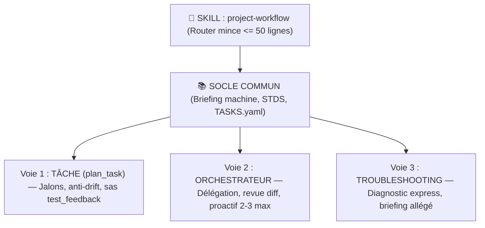
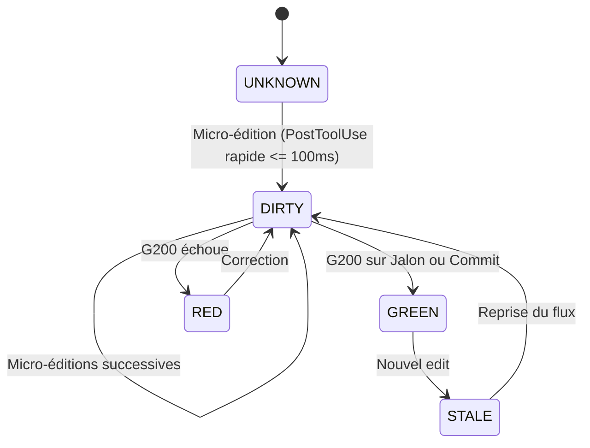

# Note Technique & Schémas — Tâche T427

> **Tâche parente** : T427 — Refonte Workflow Agents
> **Contrat associé** : [`TASK_CONTRACT_T427_WORKFLOW_SKILL_ET_CONTRAT_ETENDU.yaml`](file:///C:/_MGS/DEV/2026_Projet_YGO_ExcavatriceDragage/DOC/WFLOW/CONTRACTS/TASK_CONTRACT_T427_WORKFLOW_SKILL_ET_CONTRAT_ETENDU.yaml)
> **Rôle du document** : Fichier compagnon standardisé pour les explications détaillées, diagrammes Mermaid et graphiques d'architecture, évitant d'alourdir le contrat YAML.

---

## 1. Architecture du Routeur Mince & 3 Voies

---

## 2. Découplage des Hooks & Machine à États

---

## 3. Format Compact TDAH (≤ 120 caractères par ligne)

* `📝` **Capture** : `📝 OBS-01 · anomalie constatée · type · NEW`
* `🔬` **Analyse** : `🔬 OBS-01 · cause racine identifiée · impact plan`
* `✅` **Décision** : `✅ OBS-01 · arbitrage humain validé · révision scope/plan`
* `🧠` **Sous-agent** : `🧠 2/10 ||1 · deepseek-v4.1 audit du jalon M2`
