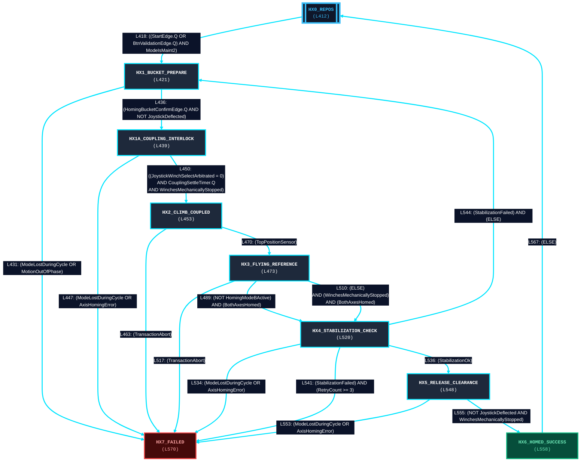

# 🧭 GRAFCET Séquenceur — Cycle Homing Machine

> **Source réelle** : `FB_CycleMachineHoming.st`  
> **Variable d'état** : `SeqStep` (`E_MachineHomingTxState`)  
> **Métriques** : **9** étapes · **17** transitions réelles extraites mécaniquement.  

---

## 📋 Tableau Récapitulatif des Étapes & Transitions Réelles

| # | Étape Source | Ligne ST | Cible | Ligne Transition | Réceptivité / Condition Réelle |
|---|---|---|---|---|---|
| 1 | `HX0_REPOS` | L412 | `HX1_BUCKET_PREPARE` | L418 | `((StartEdge.Q OR BtnValidationEdge.Q) AND ModeIsMaint2)` |
| 2 | `HX1_BUCKET_PREPARE` | L421 | `HX7_FAILED` | L431 | `(ModeLostDuringCycle OR MotionOutOfPhase)` |
| 2 | `HX1_BUCKET_PREPARE` | L421 | `HX1A_COUPLING_INTERLOCK` | L436 | `(HomingBucketConfirmEdge.Q AND NOT JoystickDeflected)` |
| 3 | `HX1A_COUPLING_INTERLOCK` | L439 | `HX7_FAILED` | L447 | `(ModeLostDuringCycle OR AxisHomingError)` |
| 3 | `HX1A_COUPLING_INTERLOCK` | L439 | `HX2_CLIMB_COUPLED` | L450 | `((JoystickWinchSelectArbitrated = 0) AND CouplingSettleTimer.Q AND WinchesMechanicallyStopped)` |
| 4 | `HX2_CLIMB_COUPLED` | L453 | `HX7_FAILED` | L463 | `(TransactionAbort)` |
| 4 | `HX2_CLIMB_COUPLED` | L453 | `HX3_FLYING_REFERENCE` | L470 | `(TopPositionSensor)` |
| 5 | `HX3_FLYING_REFERENCE` | L473 | `HX4_STABILIZATION_CHECK` | L489 | `(NOT HomingModeBActive) AND (BothAxesHomed)` |
| 5 | `HX3_FLYING_REFERENCE` | L473 | `HX4_STABILIZATION_CHECK` | L510 | `(ELSE) AND (WinchesMechanicallyStopped) AND (BothAxesHomed)` |
| 5 | `HX3_FLYING_REFERENCE` | L473 | `HX7_FAILED` | L517 | `(TransactionAbort)` |
| 6 | `HX4_STABILIZATION_CHECK` | L520 | `HX7_FAILED` | L534 | `(ModeLostDuringCycle OR AxisHomingError)` |
| 6 | `HX4_STABILIZATION_CHECK` | L520 | `HX5_RELEASE_CLEARANCE` | L536 | `(StabilizationOk)` |
| 6 | `HX4_STABILIZATION_CHECK` | L520 | `HX7_FAILED` | L541 | `(StabilizationFailed) AND (RetryCount >= 3)` |
| 6 | `HX4_STABILIZATION_CHECK` | L520 | `HX1_BUCKET_PREPARE` | L544 | `(StabilizationFailed) AND (ELSE)` |
| 7 | `HX5_RELEASE_CLEARANCE` | L548 | `HX7_FAILED` | L553 | `(ModeLostDuringCycle OR AxisHomingError)` |
| 7 | `HX5_RELEASE_CLEARANCE` | L548 | `HX6_HOMED_SUCCESS` | L555 | `(NOT JoystickDeflected AND WinchesMechanicallyStopped)` |
| 8 | `HX6_HOMED_SUCCESS` | L558 | `HX0_REPOS` | L567 | `(ELSE)` |
| 9 | `HX7_FAILED` | L570 | *(Étape terminale)* | — | *(Aucune transition sortante)* |