# 🧭 GRAFCET Séquenceur — Cycle Semi-Automatique de Dragage

> **Source réelle** : `FB_CycleSemiAuto.st`  
> **Variable d'état** : `State` (`E_AutoCycleStep`)  
> **Métriques** : **24** étapes · **30** transitions réelles extraites mécaniquement.  

```mermaid
%%{init: {
  'theme': 'base',
  'themeVariables': {
    'primaryColor': '#1e293b',
    'primaryTextColor': '#ffffff',
    'primaryBorderColor': '#00e5ff',
    'lineColor': '#00e5ff',
    'secondaryColor': '#0f172a',
    'tertiaryColor': '#1e293b',
    'edgeLabelBackground': '#0b1329',
    'textColor': '#ffffff',
    'fontSize': '12px'
  }
}}%%
flowchart TD
    %% Style CEI 60848 standard haut contraste
    classDef stepClass fill:#1e293b,stroke:#00e5ff,stroke-width:2.5px,color:#ffffff,font-family:monospace;
    classDef initialStep fill:#0f172a,stroke:#38bdf8,stroke-width:4px,color:#38bdf8,font-family:monospace;
    classDef failStep fill:#450a0a,stroke:#ef4444,stroke-width:2.5px,color:#fca5a5,font-family:monospace;
    classDef completeStep fill:#064e3b,stroke:#10b981,stroke-width:2.5px,color:#6ee7b7,font-family:monospace;

    AX0_REPOS[["<b>AX0_REPOS</b><br/>(L887)"]]:::initialStep
    AX1_INIT["<b>AX1_INIT</b><br/>(L919)"]:::stepClass
    AX2_TRANSLATE_P1["<b>AX2_TRANSLATE_P1</b><br/>(L969)"]:::stepClass
    AX3_OPEN_BUCKET["<b>AX3_OPEN_BUCKET</b><br/>(L1012)"]:::stepClass
    AX3_WAIT_DIVE_START["<b>AX3_WAIT_DIVE_START</b><br/>(L1044)"]:::stepClass
    AX4_DESCEND_DIVING["<b>AX4_DESCEND_DIVING</b><br/>(L1071)"]:::stepClass
    AX5_KOBOLD_INIT["<b>AX5_KOBOLD_INIT</b><br/>(L1100)"]:::stepClass
    AX6_SEARCH_IMMERSION["<b>AX6_SEARCH_IMMERSION</b><br/>(L1130)"]:::stepClass
    AX7_SEARCH_BOTTOM["<b>AX7_SEARCH_BOTTOM</b><br/>(L1161)"]:::stepClass
    AX8_BOTTOM_CONFIRMED["<b>AX8_BOTTOM_CONFIRMED</b><br/>(L1203)"]:::stepClass
    AX_DIVING_RETRY["<b>AX_DIVING_RETRY</b><br/>(L1247)"]:::stepClass
    AX9_RAISE_OFF_BOTTOM["<b>AX9_RAISE_OFF_BOTTOM</b><br/>(L1277)"]:::stepClass
    AX10_CLOSE_BUCKET["<b>AX10_CLOSE_BUCKET</b><br/>(L1304)"]:::stepClass
    AX10B_RACCORDEMENT_P1["<b>AX10B_RACCORDEMENT_P1</b><br/>(L1334)"]:::stepClass
    AX11_CTRL_ASCENT["<b>AX11_CTRL_ASCENT</b><br/>(L1384)"]:::stepClass
    AX12_LOADED_ASCENT["<b>AX12_LOADED_ASCENT</b><br/>(L1413)"]:::stepClass
    AX13_DRAIN_PAUSE["<b>AX13_DRAIN_PAUSE</b><br/>(L1445)"]:::stepClass
    AX14_TRANSLATE_DUMP["<b>AX14_TRANSLATE_DUMP</b><br/>(L1480)"]:::stepClass
    AX15A_DUMP_ARRIVE["<b>AX15A_DUMP_ARRIVE</b><br/>(L1508)"]:::stepClass
    AX15B_DUMP_OPEN["<b>AX15B_DUMP_OPEN</b><br/>(L1541)"]:::stepClass
    AX15D_DUMP_BUCKET_JOG["<b>AX15D_DUMP_BUCKET_JOG</b><br/>(L1579)"]:::stepClass
    AX15C_DUMP_REPOSITION["<b>AX15C_DUMP_REPOSITION</b><br/>(L1617)"]:::stepClass
    AX18_DONE_SYNC["<b>AX18_DONE_SYNC</b><br/>(L1650)"]:::stepClass
    AX_STAB["<b>AX_STAB</b><br/>(L1684)"]:::stepClass

    %% Transitions réelles extraites du code
    AX0_REPOS -->|"L916: ((StartEdge.Q OR DeadmanArmedEdge.Q)<br/>AND NOT Fault.Latched)"| AX1_INIT
    AX1_INIT -->|"L938: (InitConditionsOk)"| AX2_TRANSLATE_P1
    AX2_TRANSLATE_P1 -->|"L998: (Translation_At_P1)<br/>AND (TranslationStopTimer.Q<br/>AND DeadmanArmed<br/>AND JoystickPushOnly)"| AX3_OPEN_BUCKET
    AX3_OPEN_BUCKET -->|"L1041: (Benne_IsOpen AND NOT Benne_Busy)"| AX3_WAIT_DIVE_START
    AX3_WAIT_DIVE_START -->|"L1066: (DiveStartStopTimer.Q<br/>AND DeadmanArmed<br/>AND JoystickPush)"| AX4_DESCEND_DIVING
    AX4_DESCEND_DIVING -->|"L1097: TRUE (inconditionnel)"| AX5_KOBOLD_INIT
    AX5_KOBOLD_INIT -->|"L1127: (DeadmanArmed AND JoystickPush AND KoboldInitTimer.Q)"| AX6_SEARCH_IMMERSION
    AX6_SEARCH_IMMERSION -->|"L1158: TRUE (inconditionnel)"| AX7_SEARCH_BOTTOM
    AX7_SEARCH_BOTTOM -->|"L1200: TRUE (inconditionnel)"| AX8_BOTTOM_CONFIRMED
    AX8_BOTTOM_CONFIRMED -->|"L1241: (BottomTouchStabTimer.Q<br/>AND DiveStartStopped<br/>AND StopPositionCaptured)<br/>AND (RaiseOffBottomEff &lt;= 0.0)"| AX10_CLOSE_BUCKET
    AX8_BOTTOM_CONFIRMED -->|"L1243: (BottomTouchStabTimer.Q<br/>AND DiveStartStopped<br/>AND StopPositionCaptured)<br/>AND (ELSE)"| AX9_RAISE_OFF_BOTTOM
    AX_DIVING_RETRY -->|"L1272: (JoystickDeflected AND WinchesAtTopWindow)"| AX4_DESCEND_DIVING
    AX9_RAISE_OFF_BOTTOM -->|"L1301: (DeadmanArmed<br/>AND JoystickPull<br/>AND ExtractionStepDelayTimer.Q<br/>AND (M1_CablePosM &gt;= RaiseTargetM1)<br/>AND (M2_CablePosM &gt;= RaiseTargetM2))"| AX10_CLOSE_BUCKET
    AX10_CLOSE_BUCKET -->|"L1331: (DeadmanArmed<br/>AND JoystickPull<br/>AND Benne_CloseReached<br/>AND (Benne_IsClosed OR Benne_IsRoughlyClosed))"| AX10B_RACCORDEMENT_P1
    AX10B_RACCORDEMENT_P1 -->|"L1370: (CfgCtrlAscentDistanceM &lt;= 0.0)"| AX12_LOADED_ASCENT
    AX10B_RACCORDEMENT_P1 -->|"L1372: (ELSE)"| AX11_CTRL_ASCENT
    AX10B_RACCORDEMENT_P1 -->|"L1378: (Ax10bFallbackStopActive<br/>AND AscentStartStopTimer.Q<br/>AND DeadmanArmed<br/>AND JoystickPull)<br/>AND (CfgCtrlAscentDistanceM &lt;= 0.0)"| AX12_LOADED_ASCENT
    AX10B_RACCORDEMENT_P1 -->|"L1380: (Ax10bFallbackStopActive<br/>AND AscentStartStopTimer.Q<br/>AND DeadmanArmed<br/>AND JoystickPull)<br/>AND (ELSE)"| AX11_CTRL_ASCENT
    AX11_CTRL_ASCENT -->|"L1410: TRUE (inconditionnel)"| AX12_LOADED_ASCENT
    AX12_LOADED_ASCENT -->|"L1440: (M1TopLimitReached OR M2TopLimitReached)"| AX13_DRAIN_PAUSE
    AX13_DRAIN_PAUSE -->|"L1477: (DrainingTimer.Q OR SkipDrainEdge.Q)"| AX14_TRANSLATE_DUMP
    AX14_TRANSLATE_DUMP -->|"L1504: (Translation_At_Tremie) AND (TranslationStopTimer.Q)"| AX15A_DUMP_ARRIVE
    AX15A_DUMP_ARRIVE -->|"L1534: (SeenNeutralAfterArrival)<br/>AND (DeadmanArmed<br/>AND JoystickPush)"| AX15B_DUMP_OPEN
    AX15B_DUMP_OPEN -->|"L1571: (DeadmanArmed AND JoystickPull)"| AX15D_DUMP_BUCKET_JOG
    AX15B_DUMP_OPEN -->|"L1573: (RepositionRequest)"| AX15C_DUMP_REPOSITION
    AX15B_DUMP_OPEN -->|"L1576: (DeadmanArmed<br/>AND JoystickPush<br/>AND Benne_Done<br/>AND Benne_IsOpen)"| AX18_DONE_SYNC
    AX15D_DUMP_BUCKET_JOG -->|"L1610: (NOT JoystickDeflected)"| AX15B_DUMP_OPEN
    AX15D_DUMP_BUCKET_JOG -->|"L1614: (DeadmanArmed<br/>AND JoystickPush<br/>AND Benne_Done<br/>AND Benne_IsOpen)"| AX18_DONE_SYNC
    AX15C_DUMP_REPOSITION -->|"L1647: (NOT RepositionRequest)"| AX15B_DUMP_OPEN
    AX18_DONE_SYNC -->|"L1681: (StartEdge.Q OR (DeadmanArmed AND JoystickRight))"| AX2_TRANSLATE_P1
    linkStyle default stroke:#00e5ff,stroke-width:2.5px,color:#ffffff,fill:none;
```

---

## 📋 Tableau Récapitulatif des Étapes & Transitions Réelles

| # | Étape Source | Ligne ST | Cible | Ligne Transition | Réceptivité / Condition Réelle |
|---|---|---|---|---|---|
| 1 | `AX0_REPOS` | L887 | `AX1_INIT` | L916 | `((StartEdge.Q OR DeadmanArmedEdge.Q) AND NOT Fault.Latched)` |
| 2 | `AX1_INIT` | L919 | `AX2_TRANSLATE_P1` | L938 | `(InitConditionsOk)` |
| 3 | `AX2_TRANSLATE_P1` | L969 | `AX3_OPEN_BUCKET` | L998 | `(Translation_At_P1) AND (TranslationStopTimer.Q AND DeadmanArmed AND JoystickPushOnly)` |
| 4 | `AX3_OPEN_BUCKET` | L1012 | `AX3_WAIT_DIVE_START` | L1041 | `(Benne_IsOpen AND NOT Benne_Busy)` |
| 5 | `AX3_WAIT_DIVE_START` | L1044 | `AX4_DESCEND_DIVING` | L1066 | `(DiveStartStopTimer.Q AND DeadmanArmed AND JoystickPush)` |
| 6 | `AX4_DESCEND_DIVING` | L1071 | `AX5_KOBOLD_INIT` | L1097 | `TRUE (inconditionnel)` |
| 7 | `AX5_KOBOLD_INIT` | L1100 | `AX6_SEARCH_IMMERSION` | L1127 | `(DeadmanArmed AND JoystickPush AND KoboldInitTimer.Q)` |
| 8 | `AX6_SEARCH_IMMERSION` | L1130 | `AX7_SEARCH_BOTTOM` | L1158 | `TRUE (inconditionnel)` |
| 9 | `AX7_SEARCH_BOTTOM` | L1161 | `AX8_BOTTOM_CONFIRMED` | L1200 | `TRUE (inconditionnel)` |
| 10 | `AX8_BOTTOM_CONFIRMED` | L1203 | `AX10_CLOSE_BUCKET` | L1241 | `(BottomTouchStabTimer.Q AND DiveStartStopped AND StopPositionCaptured) AND (RaiseOffBottomEff <= 0.0)` |
| 10 | `AX8_BOTTOM_CONFIRMED` | L1203 | `AX9_RAISE_OFF_BOTTOM` | L1243 | `(BottomTouchStabTimer.Q AND DiveStartStopped AND StopPositionCaptured) AND (ELSE)` |
| 11 | `AX_DIVING_RETRY` | L1247 | `AX4_DESCEND_DIVING` | L1272 | `(JoystickDeflected AND WinchesAtTopWindow)` |
| 12 | `AX9_RAISE_OFF_BOTTOM` | L1277 | `AX10_CLOSE_BUCKET` | L1301 | `(DeadmanArmed AND JoystickPull AND ExtractionStepDelayTimer.Q AND (M1_CablePosM >= RaiseTargetM1) AND (M2_CablePosM >= RaiseTargetM2))` |
| 13 | `AX10_CLOSE_BUCKET` | L1304 | `AX10B_RACCORDEMENT_P1` | L1331 | `(DeadmanArmed AND JoystickPull AND Benne_CloseReached AND (Benne_IsClosed OR Benne_IsRoughlyClosed))` |
| 14 | `AX10B_RACCORDEMENT_P1` | L1334 | `AX12_LOADED_ASCENT` | L1370 | `(CfgCtrlAscentDistanceM <= 0.0)` |
| 14 | `AX10B_RACCORDEMENT_P1` | L1334 | `AX11_CTRL_ASCENT` | L1372 | `(ELSE)` |
| 14 | `AX10B_RACCORDEMENT_P1` | L1334 | `AX12_LOADED_ASCENT` | L1378 | `(Ax10bFallbackStopActive AND AscentStartStopTimer.Q AND DeadmanArmed AND JoystickPull) AND (CfgCtrlAscentDistanceM <= 0.0)` |
| 14 | `AX10B_RACCORDEMENT_P1` | L1334 | `AX11_CTRL_ASCENT` | L1380 | `(Ax10bFallbackStopActive AND AscentStartStopTimer.Q AND DeadmanArmed AND JoystickPull) AND (ELSE)` |
| 15 | `AX11_CTRL_ASCENT` | L1384 | `AX12_LOADED_ASCENT` | L1410 | `TRUE (inconditionnel)` |
| 16 | `AX12_LOADED_ASCENT` | L1413 | `AX13_DRAIN_PAUSE` | L1440 | `(M1TopLimitReached OR M2TopLimitReached)` |
| 17 | `AX13_DRAIN_PAUSE` | L1445 | `AX14_TRANSLATE_DUMP` | L1477 | `(DrainingTimer.Q OR SkipDrainEdge.Q)` |
| 18 | `AX14_TRANSLATE_DUMP` | L1480 | `AX15A_DUMP_ARRIVE` | L1504 | `(Translation_At_Tremie) AND (TranslationStopTimer.Q)` |
| 19 | `AX15A_DUMP_ARRIVE` | L1508 | `AX15B_DUMP_OPEN` | L1534 | `(SeenNeutralAfterArrival) AND (DeadmanArmed AND JoystickPush)` |
| 20 | `AX15B_DUMP_OPEN` | L1541 | `AX15D_DUMP_BUCKET_JOG` | L1571 | `(DeadmanArmed AND JoystickPull)` |
| 20 | `AX15B_DUMP_OPEN` | L1541 | `AX15C_DUMP_REPOSITION` | L1573 | `(RepositionRequest)` |
| 20 | `AX15B_DUMP_OPEN` | L1541 | `AX18_DONE_SYNC` | L1576 | `(DeadmanArmed AND JoystickPush AND Benne_Done AND Benne_IsOpen)` |
| 21 | `AX15D_DUMP_BUCKET_JOG` | L1579 | `AX15B_DUMP_OPEN` | L1610 | `(NOT JoystickDeflected)` |
| 21 | `AX15D_DUMP_BUCKET_JOG` | L1579 | `AX18_DONE_SYNC` | L1614 | `(DeadmanArmed AND JoystickPush AND Benne_Done AND Benne_IsOpen)` |
| 22 | `AX15C_DUMP_REPOSITION` | L1617 | `AX15B_DUMP_OPEN` | L1647 | `(NOT RepositionRequest)` |
| 23 | `AX18_DONE_SYNC` | L1650 | `AX2_TRANSLATE_P1` | L1681 | `(StartEdge.Q OR (DeadmanArmed AND JoystickRight))` |
| 24 | `AX_STAB` | L1684 | *(Étape terminale)* | — | *(Aucune transition sortante)* |