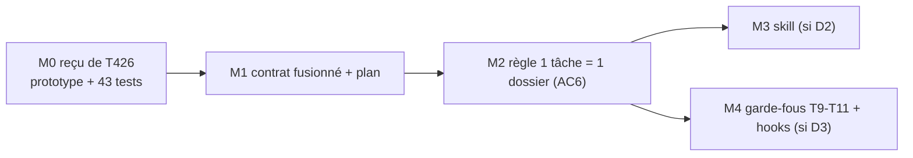

# T427 — Workflow agents (T426 fusionnée) · Plan

> 🧭 Document de travail unique de la tâche. Contrat : [`T427_WORKFLOW_AGENTS_CONTRAT_WORKFLOW_ET_FUSION_T426_20261110_v1.0.yaml`](T427_WORKFLOW_AGENTS_CONTRAT_WORKFLOW_ET_FUSION_T426_20261110_v1.0.yaml)
> 👤 Responsable : `CC01` (même personne pour T426 et T427, demande exploitant 2026-11-10) · Criticité C2 · Statut ⏳

## 1. Pourquoi une fusion
T426 (CDX01) et T427 (AGY01) modifient les mêmes fichiers (`templates/task_contract.yaml`, `check_task_contract.py`) et se contredisent sur deux points. Un challenge indépendant (2026-11-10) a conclu à une **fusion partielle, T427 survivante** : [`PREUVES/…/CHALLENGE_FUSION_RAPPORT.md`](PREUVES/20261110_SESSION_FUSION_T426_T427/CHALLENGE_FUSION_RAPPORT.md).
Fait notable : la partie `consolidation_review` de T426 **est** l'étude de « 1 tâche = 1 dossier » que l'exploitant réalise. La fusion lui donne son contrat.

## 2. Ce que chaque tâche apporte
| | T426 (étude, terminée) | T427 (cadrage, non implémentée) |
|---|---|---|
| Objet | pilotage vérifiable, contrôles en avertissement, revue A/B sur stagnation | contrat étendu (jalons, sas d'essais, quota sous-agents), note compagnon, routeur de skill |
| Livré | prototype `check_task_tracking.py` + 43 tests, commit `2a5bf86d` | rien dans le code (gabarit sans ses champs) |
| AC | `T426-AC1…8` | `AC1…5` |

## 3. Contradictions et décisions
| ID | Sujet | État |
|---|---|---|
| D1 | ID survivant | ✅ T427 |
| D2 | Skill `project-workflow` (T427-AC1) vs « aucune nouvelle skill parallèle » (T426) ; l'exploitant ne veut dépendre d'aucune skill | 🔴 ouvert — AC1 suspendue |
| D3 | Hooks Stop/PostToolUse (T427-AC4) vs « pas de hook actif modifié sans plan d'activation validé » (T426-AC7) | 🔴 ouvert — AC4 suspendue |
| D4 | Propriétaire unique | ✅ CC01 |
| D5 | Document maître : contrat YAML + plan MD (règle actuelle) ou plan MD seul + `TASKS.yaml` en index (proposition de l'autre agent) | 🔴 ouvert — YAML conservé en attendant |

## 4. Jalons


## 5. Règle « 1 tâche = 1 dossier » (proposée, à valider — AC6)
```
DOC/WFLOW/TASKS/T<ID>_<NOM>/
├─ T<ID>_<NOM>_CONTRAT_…_<DATE>_v1.0.yaml   ← le contrat (seul YAML)
├─ T<ID>_<NOM>_PLAN_<DATE>_v1.0.md          ← le plan (seul md de travail)
├─ PREUVES/<date>_SESSION_…/                ← sur validation
├─ ARCHIVES/                                ← originaux, prompts, revues intermédiaires
└─ CONTRACTS/                               ← sous-contrats délégués, sur validation
```
Conditions de migration reprises de T426 : aucune perte de contenu · liens entrants inventoriés · parcours humain et agent identiques · pas de double saisie · **table ancien→nouveau chemin validée par l'exploitant avant tout déplacement**.

## 6. Index des fichiers du dossier
| Fichier | Rôle |
|---|---|
| `ARCHIVES/…CONTRAT_T426_ORIGINE_20261101…yaml` | contrat T426 intégral (framing, control_matrix, expériences R1-R3, procédures proposées) — non repris dans le contrat fusionné |
| `ARCHIVES/…CONTRAT_T427_ORIGINE_20261104…yaml` et `…NOTE_T427_ORIGINE…md` | originaux T427 |
| `PREUVES/20261110_SESSION_FUSION_T426_T427/` | rapport de challenge de la fusion |

## 7. Vérifié / non vérifié
- ✅ `check_task_contract.py` sur le contrat fusionné : PASS (0 erreur).
- ✅ Contradictions D2 et D3 relues dans les deux contrats d'origine.
- ✅ Un save du serveur Task Manager ne change aujourd'hui que **13 lignes** de `TASKS.yaml` (affirmation « 13 000 lignes » infirmée).
- ⏳ Non rejoué : les 43 tests T426, `G530_check_contract_refs.py`.
- ⚠️ Une copie de T426 existe dans `.claude/worktrees/carte-flux/` (non lue).
