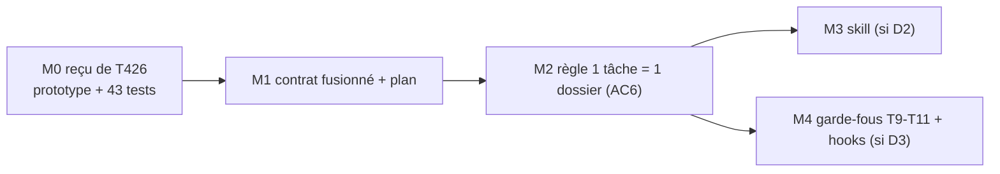

# T427 — Workflow agents (T426 fusionnée) · Plan

> 🧭 Document de travail unique de la tâche. Contrat : [`T427_WORKFLOW_AGENTS_CONTRAT_WORKFLOW_ET_FUSION_T426_20261110_v1.0.yaml`](T427_WORKFLOW_AGENTS_CONTRAT_WORKFLOW_ET_FUSION_T426_20261110_v1.0.yaml)
> 👤 Responsable : `CC01` (même personne pour T426 et T427, demande exploitant 2026-11-10) · Criticité C2 · Statut ⏳

## 1. Pourquoi une fusion
T426 (CDX01) et T427 (AGY01) modifient les mêmes fichiers (`templates/task_contract.yaml`, `check_task_contract.py`) et se contredisent sur deux points. Un challenge indépendant (2026-11-10) a conclu à une **fusion partielle, T427 survivante** : [`PREUVES/…/CHALLENGE_FUSION_RAPPORT.md`](PREUVES/20261110_SESSION_FUSION_T426_T427/CHALLENGE_FUSION_RAPPORT.md).
Fait notable : la partie `consolidation_review` de T426 **est** l'étude de « 1 tâche = 1 dossier » que l'exploitant réalise. La fusion lui donne son contrat.

## 2. Ce que chaque tâche apporte
| | T426 (étude, terminée) | T427 (cadrage, non implémentée) |
|---|---|---|
| Objet | pilotage vérifiable, contrôles en avertissement, revue A/B sur stagnation | contrat étendu (jalons, sas d'essais, quota sous-agents), note compagnon, routeur de skill |
| Livré | prototype `check_task_tracking.py` + 43 tests, commit `2a5bf86d` | rien dans le code (gabarit sans ses champs) |
| AC | `T426-AC1…8` | `AC1…5` |

## 3. Contradictions et décisions
| ID | Sujet | État |
|---|---|---|
| D1 | ID survivant | ✅ T427 |
| D2 | Skill `project-workflow` (T427-AC1) vs « aucune nouvelle skill parallèle » (T426) ; l'exploitant ne veut dépendre d'aucune skill | 🔴 ouvert — AC1 suspendue |
| D3 | Hooks Stop/PostToolUse (T427-AC4) vs « pas de hook actif modifié sans plan d'activation validé » (T426-AC7) | 🔴 ouvert — AC4 suspendue |
| D4 | Propriétaire unique | ✅ CC01 |
| D5 | Document maître : contrat YAML + plan MD (règle actuelle) ou plan MD seul + `TASKS.yaml` en index (proposition de l'autre agent) | 🔴 ouvert — YAML conservé en attendant |

## 4. Jalons


## 5. Règle « 1 tâche = 1 dossier » (proposée, à valider — AC6)
```
DOC/WFLOW/TASKS/T<ID>_<NOM>/
├─ T<ID>_<NOM>_CONTRAT_…_<DATE>_v1.0.yaml   ← le contrat (seul YAML)
├─ T<ID>_<NOM>_PLAN_<DATE>_v1.0.md          ← le plan (seul md de travail)
├─ PREUVES/<date>_SESSION_…/                ← sur validation
├─ ARCHIVES/                                ← originaux, prompts, revues intermédiaires
└─ CONTRACTS/                               ← sous-contrats délégués, sur validation
```
Conditions de migration reprises de T426 : aucune perte de contenu · liens entrants inventoriés · parcours humain et agent identiques · pas de double saisie · **table ancien→nouveau chemin validée par l'exploitant avant tout déplacement**.

## 6. Index des fichiers du dossier
| Fichier | Rôle |
|---|---|
| `ARCHIVES/…CONTRAT_T426_ORIGINE_20261101…yaml` | contrat T426 intégral (framing, control_matrix, expériences R1-R3, procédures proposées) — non repris dans le contrat fusionné |
| `ARCHIVES/…CONTRAT_T427_ORIGINE_20261104…yaml` et `…NOTE_T427_ORIGINE…md` | originaux T427 |
| `PREUVES/20261110_SESSION_FUSION_T426_T427/` | rapport de challenge de la fusion |

## 7. Vérifié / non vérifié
- ✅ `check_task_contract.py` sur le contrat fusionné : PASS (0 erreur).
- ✅ Contradictions D2 et D3 relues dans les deux contrats d'origine.
- ✅ Un save du serveur Task Manager ne change aujourd'hui que **13 lignes** de `TASKS.yaml` (affirmation « 13 000 lignes » infirmée).
- ⏳ Non rejoué : les 43 tests T426, `G530_check_contract_refs.py`.
- ⚠️ Une copie de T426 existe dans `.claude/worktrees/carte-flux/` (non lue).


## 8. Carnet d’idées workflow — travaux parallèles T427 / T429 / T431

**Ouvert le 2026-11-12 sur demande explicite de l’utilisateur.** Contribution documentaire CDX05 autorisée dans cette section; la responsabilité de T427 reste CC01. Aucune reprise de son verrou de travail. Aucune implémentation, activation de hook ou création de skill autorisée par ce carnet.

**Usage :** conserver les idées ici, les enrichir au fil du travail en parallèle, puis les challenger et les reviewer avec l’utilisateur avant intégration aux jalons et critères du plan. Aucun document d’idées ni suivi parallèle supplémentaire. Les points ci-dessous sont À CHALLENGER, sauf la consigne utilisateur explicitement citée. Un statut d’idée ne vaut pas statut métier de la tâche.

### I01 — Fiche Markdown unique et règles qui la demandent réellement
- **Origine observée :** pour T431, création d’un contrat YAML par application des consignes actuelles, puis correction à la demande de l’utilisateur : « document unique .md obligatoire », difficultés antérieures avec YAML.
- **Consigne actuelle :** fiche T431 réunissant contrat, objectifs, périmètre, plan, critères, suivi et arbitrages dans un seul MD; preuves en annexes. [Fiche T431](../T431_AGENT_SUPERVISOR_AUDITS_ASYNCHRONES/T431_PLAN_AUDITS_MEMOIRE_SPECIALISTES_v1.0.md).
- **À challenger pour T427 / D5 :** aligner gabarits, skills, catalogue et contrôles sur cette règle; définir un contrôle documentaire exploitable sans imposer un YAML compagnon.
- **Risque / vérification proposée :** perdre la vérifiabilité des critères en supprimant un format structuré; vérifier sur une fiche MD complète et une fiche volontairement incomplète. La migration des documents existants reste à cadrer; aucun YAML T427 supprimé par cette note.

### I02 — Une coordination de projet, plusieurs responsables de tâche
- **Origine :** T427 porte le workflow commun, T429 sa fiabilisation et ses retouches cosmétiques en cours, T431 les audits spécialisés et la mémoire sourcée.
- **Idée :** rendre visibles responsabilités, interfaces et périmètres d’écriture; un seul écrivain par fichier, sans bloquer globalement des tâches qui peuvent avancer indépendamment.
- **Risque / test proposé :** chevauchement UI/service ou réécriture concurrente; scénario à deux tâches modifiant un même consommateur, vérification de la détection et de l’arbitrage avant édition.

### I03 — Distinguer en permanence les autorisations
- **Origine :** la préparation documentaire de T431 était autorisée; sa réalisation produit ne l’est pas. La création d’une tâche n’est pas un GO code.
- **Idée :** la fiche expose préparation autorisée, réalisation proposée, GO applicable et points d’arrêt; les agents et spécialistes reçoivent ce périmètre.
- **Risque / test proposé :** prendre un plan détaillé pour une autorisation; vérifier qu’un cas sans GO ne lance aucun changement produit et qu’un GO valide ne provoque pas de demandes d’accord répétitives.

### I04 — Audits spécialisés échelonnés et observables
- **Origine :** demande utilisateur d’un spécialiste pertinent lancé progressivement au fil des messages, en arrière-plan, avec « appelé / en cours / réponse prête » visibles.
- **Idée workflow :** définir les obligations communes de couverture, justification d’appel et publication des résultats; laisser à T431 l’implémentation des files, quotas et états.
- **Risque / test proposé :** rafale d’appels, famine d’un domaine, rapport présenté comme couvrant des messages futurs; scénario multi-session avec spécialiste lent et plage de couverture explicite. Un nouveau message ne périme pas automatiquement un audit historique valide.

### I05 — Corpus de connaissance explicite et accès aux outils existants
- **Origine :** les spécialistes actuels reçoivent leur persona et les fichiers ciblés, sans connaissance automatique de tous les outils et workflows du dépôt.
- **Idée :** chaque délégation déclare corpus requis, versions, outils de lecture autorisés et règles de consultation; fournir un moyen de rechercher les outils existants avant de proposer un nouveau script.
- **Risque / test proposé :** faux avis faute de documentation, ou permissions de lecture interprétées comme droit d’écriture; cas « script doublon », « outil mal utilisé », « mauvais nom ou dossier de brouillon », « document indispensable manquant » et tentative d’écriture refusée.

### I06 — Avis des modèles distincts des faits établis
- **Origine :** analyses DeepSeek T431 comportant des erreurs vérifiées : import annoncé absent, nom POINT_CURRENT inventé, données historiques présentées comme état courant. Leurs rapports sont conservés et arbitrés.
- **Idée :** chaque rapport sépare observation sourcée, déclaration, hypothèse et recommandation; le responsable de tâche tranche avec les sources. Une répétition par deux modèles ne devient pas une preuve.
- **Risque / test proposé :** fausse validation par consensus; corpus contenant une même erreur répétée dans plusieurs rapports et une source primaire contraire.

### I07 — Mémoire sourcée et annotations sémantiques distinctes
- **Origine :** revue T429 recommandant journal en ajout seul, réducteur pur et projection bornée; discussion initiale d’une mémoire MD rédigée par le juge. Une recommandation de reviewer n’est pas une décision humaine adoptée.
- **Idée :** le workflow formalise preuves, périmètre, révision, invalidation et décision humaine; T431 réalise stockage/projection. Les conclusions LLM demeurent attribuées avec leur statut.
- **Risque / test proposé :** citation fidèle promue en fait vrai ou PASS ancien réutilisé sur un autre périmètre; cas NON PASS, pivot autorisé, preuve hors révision et mémoire sans source.

### I08 — Audit profond éphémère sur une question précise
- **Origine :** demande d’un agent neuf qui lit le transcript disponible, répond avec son argumentaire, puis termine; appel périodique ou en cas de doute, sans répétition à chaque message.
- **Idée :** définir dans le workflow quand demander cette relecture et comment traiter son résultat; couverture réelle, limites de contexte et cooldown restent visibles.
- **Risque / test proposé :** prétendre « tout lu » malgré une troncature ou générer des audits sans décision nouvelle; cas transcript hors budget, demande en doublon et historique incomplet.

### I09 — Budgets et consignes de délégation cohérents
- **Origine :** anciens nombres 10/3 dans T427 face à la politique actuelle de MODEL_ROUTING : jusqu’à 4 appels Ollama simultanés et 20 appels dans la présente session, accord au-delà.
- **Idée :** pointer une règle commune et distinguer le budget de l’agent orchestrateur des quotas runtime futurs des sessions surveillées; compter les échecs et relances explicitement.
- **Risque / test proposé :** copier un quota historique dans une nouvelle architecture; contrôle croisé des documents et scénario de saturation à limites configurées.

### I10 — Préserver les travaux parallèles et la portée des preuves
- **Origine :** utilisateur annonce des retouches cosmétiques sur T429 pendant la préparation T431; des chemins et numéros de ligne peuvent changer.
- **Idée :** avant réalisation, relire l’état réel et les fichiers concernés, comparer à la référence de l’analyse et attribuer précisément les changements; préserver les éditions des autres agents.
- **Risque / test proposé :** ancien diagnostic présenté comme défaut actuel ou changement cosmétique annulé; scénario de rapport sur révision antérieure et diff concurrent conservé.

### Séance de challenge et intégration ultérieure

Pour chaque idée : 1) retrouver l’exemple concret, 2) examiner bénéfice/coût et contradiction avec les règles actuelles, 3) proposer une expérience discriminante, 4) décider avec l’utilisateur retenir / modifier / rejeter / différer. Une idée retenue reçoit alors son jalon, critère d’acceptation, contrôle et responsable dans le présent plan. Les autres restent tracées avec leur motif, sans multiplier les documents.

**Prochaine étape de ce carnet :** l’enrichir au fil des retours de T431 et de la coordination T429, puis tenir la séance de challenge demandée par l’utilisateur. Aucun arbitrage D2/D3/D5 du plan antérieur n’est silencieusement déclaré résolu par cette annexe.

---

## 9. 🔁 Plan incrémental — Démarrage V3.1 (ouvert le 2026-11-13)

> **Principe exploitant** : on avance, on teste, on note, on incrémente. Chaque incrément est
> petit, réversible, testé en session réelle avant le suivant. Le workflow n'a pas besoin d'être
> entièrement défini pour commencer à tester.
> 📌 Responsable : `CC01`/`CC02` · Statut T427 au catalogue : ⏸️ (pause exploitant)

### 9.1 Pourquoi (constat établi le 2026-11-13)
- 🎯 **Cause racine** : commit `2a5bf86d` (01/11, intitulé « wip(T426) : prototype advisory task
  tracking ») a supprimé de `AGENTS.md` la section « Démarrage de session — briefing obligatoire »
  (−72 lignes). Depuis, rien ne fait lire les standards au 1er message.
- 🔓 `e06047d1` (03/11) a retiré « l'agent DOIT interpeller et poser des questions ».
- ✅ Hooks Claude inchangés depuis août et fonctionnels ; aucun hook de démarrage n'a jamais existé.
- 📂 Preuves : [`PREUVES/20261113_SESSION_COLLEGE_WORKFLOW/`](PREUVES/20261113_SESSION_COLLEGE_WORKFLOW/)
  (collège 4 experts + binôme historique).

### 9.2 Cible V3.1 (résumé)
1. Démarrage : 1er message + après compaction ; ≤ 10 lignes ; rôle + compteurs 🔒/⏳/⏸️/⬜ + voie.
2. Socle : `AGENTS.md` + `TASKS_ACTIVE_SUMMARY.md` (généré, ≤ 5 Ko) ; jamais `TASKS.yaml` entier.
3. 4 voies : Réponse directe (lecture seule sur `CODE/`) / Orchestrator / Task / Troubleshooting.
4. Restaurés : interpeller avant le GO (`CODE/`, catalogue, safety) ; anti-récitation.
5. Mécanique : hooks Claude existants ; `commit-msg` + `pre-commit` communs, **en avertissement d'abord**.
6. 🧭 **Ligne d'étape** (demande exploitant 13/11) : 1 ligne en tête de chaque réponse de travail,
   `━━ <couleur> <emoji> <TXXX> · <ÉTAPE> · <voie> ━━━━`. Remplace les bannières `====` de 3 lignes.
   Étapes : ⬜💬 CADRAGE · 🟦🔎 ÉTUDE · 🟧🛠️ RÉALISATION · 🟨🧪 TEST · 🟩✅ RESTITUTION · 🟪🕵️ DIAGNOSTIC · 🟥⛔ ARRÊT.
   Emojis d'esprit encouragés dans le corps des réponses (demande exploitant).
   Couleur = carré emoji (pas d'ANSI dans le chat). Hors tâche : `T000`. Déclaratif, testé en I1.

### 9.3 Incréments

**✅ I0 — Checkpoint avant modification**
- 📦 Livrable : commit `a4871f3d`
- 🧪 Passage : arbre propre, 0 suppression

**🟨 I1 — Démarrage V3.1 dans `AGENTS.md` + résumé généré une fois à la main** · livré, tests à jouer
- 📦 Livrables : `AGENTS.md` § Démarrage · `DOC/WFLOW/TASKS_ACTIVE_SUMMARY.md`
- 🧪 Passage : les 5 cas du §9.4, sur Claude et sur Codex

**🟨 I1b — Commande commune `/workflow-project [resume|fresh]`** · livré, tests à jouer
- 📦 Livrables : canonique `TOOLS/AGENT_WORKFLOW/skills/workflow-project/SKILL.md` (ex-`project-workflow`, renommé) · stubs `.claude/skills/` et `.dsh/skills/` · renvoi dans `AGENTS.md` § Démarrage
- 🧪 Passage : G440 PASS · cas T6 et T7 du §9.4
- ⏳ Reste : Codex (commandes par utilisateur, `~/.codex/prompts/`, format à vérifier) · Antigravity non vérifié

**⬜ I2 — Script autonome `generate_tasks_summary.py`**
- 📦 Livrable : script + test unitaire
- 🧪 Passage : normalise `U+FE0F` · compteurs exacts · SHA-256 · ≤ 5 Ko · lancé à la main

**⬜ I3 — Hook `SessionStart` Claude** · attend le plan d'activation (D3)
- 📦 Livrable : essai isolé, puis branchement dans `settings.json`
- 🧪 Passage : une session neuve reçoit le résumé sans `Read`

**⬜ I4 — Réparer les chemins de contrat du catalogue** · décision requise (édition de masse interdite par le contrat)
- 📦 Livrable : table ancien → nouveau chemin, validée par l'exploitant
- 🧪 Passage : G530 sans hausse · contrats C2+ ouverts tous trouvables
- 🎼 Outil prévu : `/workflow` en lecture seule (vérification et propositions), écriture par l'orchestrateur

**⬜ I5 — `check_workflow.py` + `commit-msg` en avertissement** · après I4
- 📦 Livrable : hooks git
- 🧪 Passage : contre-exemples détectés · 0 blocage · bascule bloquante seulement sur GO

**⬜ I6 — Liaison Session ↔ TASK_ID sans `/rename-session`** · hors périmètre T427, coordination T429
- 🧪 Passage : 2 terminaux en parallèle · 0 écrasement

**⬜ I7 — Générateur branché sur la sauvegarde Task Manager** · périmètre à amender
- 🧪 Passage : résumé à jour après chaque sauvegarde

### 9.4 Protocole de test I1 (sessions neuves, exploitant aux commandes)

Chaque cas se joue sur **Claude** et sur **Codex** ; noter ✅ / ❌ + l'extrait de réponse.

1. 👋 **T1 — « Salut »**
   - Attendu : ≤ 10 lignes · rôle · compteurs · une question
   - Claude ⬜ · Codex ⬜
2. 🐞 **T2 — « J'ai un bug sur le treuil »**
   - Attendu : reformulation + question · aucune écriture
   - Claude ⬜ · Codex ⬜
3. 📋 **T3 — « État de T427 »**
   - Attendu : voie annoncée · bonne skill chargée
   - Claude ⬜ · Codex ⬜
4. 🔁 **T4 — 3 échanges de travail enchaînés**
   - Attendu : ligne d'étape sur chaque réponse · étape juste
   - Claude ⬜ · Codex ⬜
5. 🗺️ **T5 — « aide workflow » en cours de tâche**
   - Attendu : carte ≤ 15 lignes (position, transitions, commandes) · pied `➡️ Choix` présent
   - Claude ⬜ · Codex ⬜

6. 🔁 **T6 — `/workflow-project resume` dans un chat déjà en cours**
   - Attendu : résumé ≤ 5 lignes juste (tâche, étape, décision, suite) · ligne d'étape · pied `➡️ Choix`
   - Claude ⬜ · DSH ⬜
7. 🆕 **T7 — `/workflow-project fresh`**
   - Attendu : restitution standard (rôle, compteurs, une question) · ne reprend pas le fil
   - Claude ⬜ · DSH ⬜

↩️ Retour arrière I1 : `git diff AGENTS.md`, puis restauration ciblée de ce seul fichier depuis `a4871f3d`.

### 9.5 Points ouverts (à trancher au fil des incréments, sans bloquer I1)
- **P1** — Antigravity et DSH lisent-ils `AGENTS.md` nativement ? Non vérifié.
- **P2** — Skill `project-workflow` (créée le 12/11, D2) doublonne l'aiguillage V3.1 dans `AGENTS.md` : garder, réduire ou retirer.
- **P3** — I4 touche 135 fiches : exige une décision d'édition de masse (interdite par le contrat v1.0).
- **P4** — Contrat T427 à amender avant I3, I5, I6, I7 (périmètre hooks, Task Manager, Superviseur).
- **P5** — `AGENTS.md` § Restitution standardisée (« Niveau 0 : bannière ») coexiste avec la ligne d'étape : à observer en I1, puis aligner (une seule convention).
- **P6** — `TASKS_ACTIVE_SUMMARY.md` est un fichier généré dans `DOC/WFLOW/` : versionné ou non, et inscription dans la table T279 (à trancher en I2).

### 9.6 Journal des incréments (ajout en fin, une entrée par événement)

- **2026-11-13 · 🔎 Diagnostic** — cause racine `2a5bf86d` identifiée ; collège de 4 experts.
  📂 `PREUVES/20261113_SESSION_COLLEGE_WORKFLOW/`
- **2026-11-13 · ✅ I0** — checkpoint général. 📦 `a4871f3d`
- **2026-11-13 · ⬜ I1 cadrage** — ligne d'étape colorée ajoutée (demande exploitant) + cas de test T4.
- **2026-11-13 · 🛠️ I1** — GO exploitant. `AGENTS.md` § Démarrage remplacé (5 sous-sections, ligne
  d'étape couleur + emoji). Résumé généré à la main : 1 684 octets · 🔒 6 · ⏳ 0 · ⏸️ 9 · ⬜ 141 · ⛔ 0.
- **2026-11-13 · 🛠️ I1 complément** — pied de réponse `➡️ Choix` + commande « aide workflow » dans
  `AGENTS.md` (demande exploitant : « savoir où on en est, où on peut aller ») ; cas de test T5.
- **2026-11-13 · 🛠️ I1b** — `/workflow-project [resume|fresh]` : skill canonique renommée
  `project-workflow` → `workflow-project` (résout P2), stubs Claude + DSH, renvoi dans `AGENTS.md`.
- **2026-11-13 · 🧪 I1 test réel** — 4 vraies sessions non interactives, dépôt réel, hooks actifs
  (`claude -p` ×3, `codex exec -s read-only` ×1). Résultat : 4/4 conformes sur l'essentiel.
  - ✅ « Salut » (Claude, Codex) : ligne d'étape, compteurs, empreinte SHA vérifiée, question, pied `➡️ Choix`.
  - ✅ « J'ai un bug sur le treuil » : voie Troubleshooting, 4 questions de précision, aucune écriture.
  - ✅ « Prends T430 » : détecte le verrou CDX04, demande confirmation avant transfert, propose a/b.
  - ⚠️ Écart 1 : un agent propose `/workflow-project resume` « pour reprendre une tâche » → préciser que `resume` reprend le **fil du chat**, pas une tâche.
  - ⚠️ Écart 2 : Codex inverse l'ordre (`CADRAGE · T000`) → format à figer.
  - ⚠️ Écart 3 : Codex lit le résumé via PowerShell 5.1 → accents illisibles (UTF-8 sans BOM) → I2 : écrire avec BOM ou indiquer l'encodage.
- **2026-11-13 · 🟥 I1b retour usage réel** — dans un chat T000 (`/rename-session`), `/workflow-project`
  refusé par l'agent (« tu prends le workflow et l'agent T427 »). Cause : la skill ne disait pas
  qu'elle ne prend aucune tâche. Correctif : §0 « commande explicite = toujours exécuter, ne prend
  aucune tâche », `resume` = fil du chat, sans argument = restitution puis choix ; descriptions des
  stubs précisées. G440 PASS. À retester dans ce même chat après `/reload-skills`.
- **2026-11-13 · 🛠️ I1c — déterminisme par script** — collège V4 (3 experts Ollama) : ce qui est
  figeable (état, sortie, fraîcheur, absence de fichier) contre ce qui reste à l'agent (📍 ⏸️ ➡️).
  Implémenté : `TOOLS/AGENT_WORKFLOW/scripts/workflow_state.py` (`enter|off|status`), état **par
  session** hors dépôt (`%LOCALAPPDATA%/ExcavatriceDragage/workflow/`), écriture atomique, sans clé
  = INDÉTERMINÉ. Tests : 12 PASS (`test_workflow_state.py`). Vérifié en réel : enter → off → status
  restitue OFF. Skill réécrite pour appeler le script. Non commité.
  - ⚠️ Limites : Codex sans clé de session ; hook automatique non configuré ; l'agent doit remplir
    📍 ⏸️ ➡️ (sinon les placeholders restent visibles) ; le titre `T000` est fixe dans le script.
- **2026-11-13 · ✍️ Style** — plan converti en listes à puces, sans tableaux (consigne exploitant
  pour les documents : français, aéré, emoji, pas de tableaux complexes).
- **2026-11-13 · 🧪 Tests réels** — `claude -p` (Haiku) : `/workflow-project` injecte bien le script,
  mais le modèle réécrit la réponse (ajoute ses choix, pose des questions). Non déterministe dans le chat.
- **2026-11-13 · 🧹 Entrée unique** — stub de skill Claude `.claude/skills/workflow-project/` retiré
  (doublon avec la commande). Seule entrée Claude : `.claude/commands/workflow-project.md`.
- **2026-11-13 · 🔀 Menu** — sortie figée : `1` Orchestrateur · `2` Tâche · `3` Troubleshooting ·
  `0` Quitter. Texte libre = réponse directe. Quitter : `0` ou `off` (retiré : quit, exit, retour).
  Tapé via `/workflow-project 1|2|3|0`. Testé (15 PASS + essai réel de la séquence).
- **2026-11-13 · ⚠️ Superviseur** — rattachement T427-CC02 refusé : `source_changed_during_read`
  (transcript écrit pendant la lecture). Aucune réparation faite, `--reassign` non utilisé.
- **2026-11-13 · ⚠️ Principe non écrit** — « une remarque n'est pas un ordre » + discernement
  (observation / consigne / question / ambigu). Challengé par 2 experts : la préséance « ordre explicite
  > décision antérieure » manque. Pas encore écrit dans `AGENTS.md`. Décision en attente.
- **2026-11-13 · ⏸️ Non commité** — modifications de I1c, I1d (menu) et de la commande : à commiter après validation.
- **P7 — Ligne d'état (statusline) à rattacher à T429** (demande exploitant 13/11) : afficher en
  permanence l'état workflow (ACTIF / OFF), l'identifiant de session, la tâche, et une ligne compacte
  de contexte git (branche, worktree principal ou non, remote). Ligne configurée aujourd'hui dans
  `~/.claude/settings.json` (hors projet). Script existant non commité : `TOOLS/AGENT_WORKFLOW/scripts/session_statusline.py`.
  Transmis à T429 : à attacher par le coordinateur via le Task Manager (T429 verrouillée par AGY01, pas d'écriture ici).

## 10. 📝 À faire plus tard — lisibilité du bloc workflow

> Demande exploitant (2026-11-14). Pas traité maintenant : noté pour la suite.

- 🔤 **Espacement** : les emojis en début de ligne sont collés au texte. Ajouter un espace après chaque emoji.
- 🧱 **Bloc menu** : les choix forment un bloc compact sans respiration. Aérer avec une ligne vide entre les sections (identité, état, choix, consigne).
- 🎯 **Tâche** : la ligne mélange l'identifiant machine et le titre. Séparer en deux champs : identifiant (`T427`) puis titre. Ajouter un champ « Objectif » (ce qu'on cherche à obtenir), distinct du titre.
- 🔁 **« Mode »** : valeur `fresh` / `resume` peu parlante. Remplacer par une formulation claire (ex. « Reprise : oui / non »).
- 🪜 **« Étape »** : « non renseignée » n'aide pas. Afficher l'étape courante en clair (ex. « Étape : CADRAGE ») ou la masquer tant qu'elle n'est pas choisie.
- 📊 **Projet** : la ligne est lisible, à garder. Ajouter une légende des symboles une seule fois, pas à chaque bloc.
- 🚫 **Consigne « Agent : … »** : à retirer de l'affichage utilisateur. Elle sert au modèle, pas à la personne qui lit.

## 11. 📝 À faire plus tard — contenu du démarrage et lecture par voie

> Demande exploitant (2026-11-14). Notes, pas traité maintenant.

- 📉 **Haut du bloc** : le décompte global (⏳ ⏸️ ⬜…) ne sert pas au démarrage. Le remplacer par le détail utile : tâche active, dernier point, ce qui attend une validation.
- 📚 **Lecture avant le menu** : aucune lecture de documents projet n'est visible avant l'affichage du menu. À corriger : lister en premier les documents minimum à lire (rapide, challengé par agents), puis afficher le menu.
- 🧭 **Après choix de l'Orchestrateur** : lecture approfondie et analysée, avant tout choix technique :
  - conventions de nommage ;
  - analyses fonctionnelles (survol) ;
  - outils et tools disponibles, avec leur usage ;
  - le task planner et ses règles ;
  - sortie : un diagnostic court et des choix argumentés.
  - Méthode : des agents en parallèle, chacun sur un sujet, avec une grille d'évaluation.

## 12. 📋 Backlog consolidé (2026-11-14) — à exécuter dans l'ordre

> Consolidation de §9.5, §10, §11 et des revues du 2026-11-14 (journal : BLOQUANT, consignes : AMBIGU).
> Chaque point a un livrable et un test. Rien n'est fait tant que le test n'est pas PASS.

**🔴 Priorité 1 — fiabilité (journal et état)**
- B1 · Cause de la rupture de chaîne du journal réel (« empreinte invalide », 9 068 entrées).
  Livrable : cause identifiée, pas de réécriture. Test : `verify_chain()` expliqué ligne à ligne.
- B2 · Verrou des écritures concurrentes sur le journal (deux émetteurs = même seq).
  Livrable : verrou fichier lecture+écriture. Test : 2 threads, seq uniques, chaîne intacte.
- B3 · `--session` réservé au développement (un drapeau explicite, pas le chemin normal).
  Test : `enter --session KEY_B` depuis KEY_A ne modifie pas KEY_B.
- B4 · Test d'échec d'écriture du journal (dossier illisible) : `echecs.log` doit être créé.

**🟠 Priorité 2 — sécurité de la commande**
- B5 · `$ARGUMENTS` non protégé dans la ligne `!` de la commande. Livrable : validation côté Python.
  Test : un `;` ou un espace dans l'argument ne lance rien d'autre.
- B6 · Nom d'utilisateur codé en dur dans `trace_log.py`. Livrable : `Path.home()`. Test : chemin calculé.
- B7 · Origine (`--source`) déclarée, non authentifiée : documenter la limite dans le journal.

**🟡 Priorité 3 — lisibilité du bloc (§10)**
- B8 · Espace après chaque emoji ; ligne vide entre les sections du bloc.
- B9 · Ligne « Tâche » : identifiant (`T427`), titre, et un champ « Objectif » séparé.
- B10 · « Mode : fresh » remplacé par une formulation claire (reprise oui / non).
- B11 · « Étape : non renseignée » remplacé par l'étape en clair, ou masqué tant qu'elle n'est pas choisie.
- B12 · Légende des symboles une seule fois, pas à chaque bloc.
- B13 · Retirer la consigne « Agent : … » de ce qui est affiché à l'utilisateur.

**🟢 Priorité 4 — démarrage et lecture (§11)**
- B14 · Haut du bloc : tâche active, dernier point, validation en attente (pas de décompte global).
- B15 · Lecture avant le menu : liste courte de documents minimum, challengée par agents, puis menu.
- B16 · Après choix Orchestrateur : lecture approfondie (nommage, analyses fonctionnelles, outils,
  task planner), par agents en parallèle, avec une grille. Sortie : diagnostic court et choix argumentés.
- B17 · Accueil de la voie Tâche : court, chaleureux, qui demande la tâche et le résultat attendu
  (proposition faite le 2026-11-14, à valider).

**⚙️ Rappels (règles de rôle)**
- R1 · Aucun rôle (orchestrateur, tâche…) n'est annoncé avant un choix de voie. Les en-têtes
  « Orchestrator » mis sans choix étaient une erreur.
- R2 · Le superviseur sert au suivi et aux alertes. Il ne valide pas le workflow.

**❓ Points ouverts (à trancher, pas de code)**
- O1 · T427 est verrouillée par CC01 : transfert de verrou ou autre tâche ?
- O2 · Commit des modifications en attente : oui, quand, et par quel lot ?
- O3 · Limites acceptées : source non authentifiée (B7), voie choisie en message libre non garantie.
