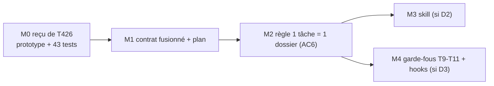

# T427 — Workflow agents (T426 fusionnée) · Plan

> 🧭 Document de travail unique de la tâche. Contrat : [`T427_WORKFLOW_AGENTS_CONTRAT_WORKFLOW_ET_FUSION_T426_20261110_v1.0.yaml`](T427_WORKFLOW_AGENTS_CONTRAT_WORKFLOW_ET_FUSION_T426_20261110_v1.0.yaml)
> 👤 Responsable : `CC01` (même personne pour T426 et T427, demande exploitant 2026-11-10) · Criticité C2 · Statut ⏳

## 1. Pourquoi une fusion
T426 (CDX01) et T427 (AGY01) modifient les mêmes fichiers (`templates/task_contract.yaml`, `check_task_contract.py`) et se contredisent sur deux points. Un challenge indépendant (2026-11-10) a conclu à une **fusion partielle, T427 survivante** : [`PREUVES/…/CHALLENGE_FUSION_RAPPORT.md`](PREUVES/20261110_SESSION_FUSION_T426_T427/CHALLENGE_FUSION_RAPPORT.md).
Fait notable : la partie `consolidation_review` de T426 **est** l'étude de « 1 tâche = 1 dossier » que l'exploitant réalise. La fusion lui donne son contrat.

## 2. Ce que chaque tâche apporte
| | T426 (étude, terminée) | T427 (cadrage, non implémentée) |
|---|---|---|
| Objet | pilotage vérifiable, contrôles en avertissement, revue A/B sur stagnation | contrat étendu (jalons, sas d'essais, quota sous-agents), note compagnon, routeur de skill |
| Livré | prototype `check_task_tracking.py` + 43 tests, commit `2a5bf86d` | rien dans le code (gabarit sans ses champs) |
| AC | `T426-AC1…8` | `AC1…5` |

## 3. Contradictions et décisions
| ID | Sujet | État |
|---|---|---|
| D1 | ID survivant | ✅ T427 |
| D2 | Skill `project-workflow` (T427-AC1) vs « aucune nouvelle skill parallèle » (T426) ; l'exploitant ne veut dépendre d'aucune skill | 🔴 ouvert — AC1 suspendue |
| D3 | Hooks Stop/PostToolUse (T427-AC4) vs « pas de hook actif modifié sans plan d'activation validé » (T426-AC7) | 🔴 ouvert — AC4 suspendue |
| D4 | Propriétaire unique | ✅ CC01 |
| D5 | Document maître : contrat YAML + plan MD (règle actuelle) ou plan MD seul + `TASKS.yaml` en index (proposition de l'autre agent) | 🔴 ouvert — YAML conservé en attendant |

## 4. Jalons


## 5. Règle « 1 tâche = 1 dossier » (proposée, à valider — AC6)
```
DOC/WFLOW/TASKS/T<ID>_<NOM>/
├─ T<ID>_<NOM>_CONTRAT_…_<DATE>_v1.0.yaml   ← le contrat (seul YAML)
├─ T<ID>_<NOM>_PLAN_<DATE>_v1.0.md          ← le plan (seul md de travail)
├─ PREUVES/<date>_SESSION_…/                ← sur validation
├─ ARCHIVES/                                ← originaux, prompts, revues intermédiaires
└─ CONTRACTS/                               ← sous-contrats délégués, sur validation
```
Conditions de migration reprises de T426 : aucune perte de contenu · liens entrants inventoriés · parcours humain et agent identiques · pas de double saisie · **table ancien→nouveau chemin validée par l'exploitant avant tout déplacement**.

## 6. Index des fichiers du dossier
| Fichier | Rôle |
|---|---|
| `ARCHIVES/…CONTRAT_T426_ORIGINE_20261101…yaml` | contrat T426 intégral (framing, control_matrix, expériences R1-R3, procédures proposées) — non repris dans le contrat fusionné |
| `ARCHIVES/…CONTRAT_T427_ORIGINE_20261104…yaml` et `…NOTE_T427_ORIGINE…md` | originaux T427 |
| `PREUVES/20261110_SESSION_FUSION_T426_T427/` | rapport de challenge de la fusion |

## 7. Vérifié / non vérifié
- ✅ `check_task_contract.py` sur le contrat fusionné : PASS (0 erreur).
- ✅ Contradictions D2 et D3 relues dans les deux contrats d'origine.
- ✅ Un save du serveur Task Manager ne change aujourd'hui que **13 lignes** de `TASKS.yaml` (affirmation « 13 000 lignes » infirmée).
- ⏳ Non rejoué : les 43 tests T426, `G530_check_contract_refs.py`.
- ⚠️ Une copie de T426 existe dans `.claude/worktrees/carte-flux/` (non lue).


## 8. Carnet d’idées workflow — travaux parallèles T427 / T429 / T431

**Ouvert le 2026-11-12 sur demande explicite de l’utilisateur.** Contribution documentaire CDX05 autorisée dans cette section; la responsabilité de T427 reste CC01. Aucune reprise de son verrou de travail. Aucune implémentation, activation de hook ou création de skill autorisée par ce carnet.

**Usage :** conserver les idées ici, les enrichir au fil du travail en parallèle, puis les challenger et les reviewer avec l’utilisateur avant intégration aux jalons et critères du plan. Aucun document d’idées ni suivi parallèle supplémentaire. Les points ci-dessous sont À CHALLENGER, sauf la consigne utilisateur explicitement citée. Un statut d’idée ne vaut pas statut métier de la tâche.

### I01 — Fiche Markdown unique et règles qui la demandent réellement
- **Origine observée :** pour T431, création d’un contrat YAML par application des consignes actuelles, puis correction à la demande de l’utilisateur : « document unique .md obligatoire », difficultés antérieures avec YAML.
- **Consigne actuelle :** fiche T431 réunissant contrat, objectifs, périmètre, plan, critères, suivi et arbitrages dans un seul MD; preuves en annexes. [Fiche T431](../T431_AGENT_SUPERVISOR_AUDITS_ASYNCHRONES/T431_PLAN_AUDITS_MEMOIRE_SPECIALISTES_v1.0.md).
- **À challenger pour T427 / D5 :** aligner gabarits, skills, catalogue et contrôles sur cette règle; définir un contrôle documentaire exploitable sans imposer un YAML compagnon.
- **Risque / vérification proposée :** perdre la vérifiabilité des critères en supprimant un format structuré; vérifier sur une fiche MD complète et une fiche volontairement incomplète. La migration des documents existants reste à cadrer; aucun YAML T427 supprimé par cette note.

### I02 — Une coordination de projet, plusieurs responsables de tâche
- **Origine :** T427 porte le workflow commun, T429 sa fiabilisation et ses retouches cosmétiques en cours, T431 les audits spécialisés et la mémoire sourcée.
- **Idée :** rendre visibles responsabilités, interfaces et périmètres d’écriture; un seul écrivain par fichier, sans bloquer globalement des tâches qui peuvent avancer indépendamment.
- **Risque / test proposé :** chevauchement UI/service ou réécriture concurrente; scénario à deux tâches modifiant un même consommateur, vérification de la détection et de l’arbitrage avant édition.

### I03 — Distinguer en permanence les autorisations
- **Origine :** la préparation documentaire de T431 était autorisée; sa réalisation produit ne l’est pas. La création d’une tâche n’est pas un GO code.
- **Idée :** la fiche expose préparation autorisée, réalisation proposée, GO applicable et points d’arrêt; les agents et spécialistes reçoivent ce périmètre.
- **Risque / test proposé :** prendre un plan détaillé pour une autorisation; vérifier qu’un cas sans GO ne lance aucun changement produit et qu’un GO valide ne provoque pas de demandes d’accord répétitives.

### I04 — Audits spécialisés échelonnés et observables
- **Origine :** demande utilisateur d’un spécialiste pertinent lancé progressivement au fil des messages, en arrière-plan, avec « appelé / en cours / réponse prête » visibles.
- **Idée workflow :** définir les obligations communes de couverture, justification d’appel et publication des résultats; laisser à T431 l’implémentation des files, quotas et états.
- **Risque / test proposé :** rafale d’appels, famine d’un domaine, rapport présenté comme couvrant des messages futurs; scénario multi-session avec spécialiste lent et plage de couverture explicite. Un nouveau message ne périme pas automatiquement un audit historique valide.

### I05 — Corpus de connaissance explicite et accès aux outils existants
- **Origine :** les spécialistes actuels reçoivent leur persona et les fichiers ciblés, sans connaissance automatique de tous les outils et workflows du dépôt.
- **Idée :** chaque délégation déclare corpus requis, versions, outils de lecture autorisés et règles de consultation; fournir un moyen de rechercher les outils existants avant de proposer un nouveau script.
- **Risque / test proposé :** faux avis faute de documentation, ou permissions de lecture interprétées comme droit d’écriture; cas « script doublon », « outil mal utilisé », « mauvais nom ou dossier de brouillon », « document indispensable manquant » et tentative d’écriture refusée.

### I06 — Avis des modèles distincts des faits établis
- **Origine :** analyses DeepSeek T431 comportant des erreurs vérifiées : import annoncé absent, nom POINT_CURRENT inventé, données historiques présentées comme état courant. Leurs rapports sont conservés et arbitrés.
- **Idée :** chaque rapport sépare observation sourcée, déclaration, hypothèse et recommandation; le responsable de tâche tranche avec les sources. Une répétition par deux modèles ne devient pas une preuve.
- **Risque / test proposé :** fausse validation par consensus; corpus contenant une même erreur répétée dans plusieurs rapports et une source primaire contraire.

### I07 — Mémoire sourcée et annotations sémantiques distinctes
- **Origine :** revue T429 recommandant journal en ajout seul, réducteur pur et projection bornée; discussion initiale d’une mémoire MD rédigée par le juge. Une recommandation de reviewer n’est pas une décision humaine adoptée.
- **Idée :** le workflow formalise preuves, périmètre, révision, invalidation et décision humaine; T431 réalise stockage/projection. Les conclusions LLM demeurent attribuées avec leur statut.
- **Risque / test proposé :** citation fidèle promue en fait vrai ou PASS ancien réutilisé sur un autre périmètre; cas NON PASS, pivot autorisé, preuve hors révision et mémoire sans source.

### I08 — Audit profond éphémère sur une question précise
- **Origine :** demande d’un agent neuf qui lit le transcript disponible, répond avec son argumentaire, puis termine; appel périodique ou en cas de doute, sans répétition à chaque message.
- **Idée :** définir dans le workflow quand demander cette relecture et comment traiter son résultat; couverture réelle, limites de contexte et cooldown restent visibles.
- **Risque / test proposé :** prétendre « tout lu » malgré une troncature ou générer des audits sans décision nouvelle; cas transcript hors budget, demande en doublon et historique incomplet.

### I09 — Budgets et consignes de délégation cohérents
- **Origine :** anciens nombres 10/3 dans T427 face à la politique actuelle de MODEL_ROUTING : jusqu’à 4 appels Ollama simultanés et 20 appels dans la présente session, accord au-delà.
- **Idée :** pointer une règle commune et distinguer le budget de l’agent orchestrateur des quotas runtime futurs des sessions surveillées; compter les échecs et relances explicitement.
- **Risque / test proposé :** copier un quota historique dans une nouvelle architecture; contrôle croisé des documents et scénario de saturation à limites configurées.

### I10 — Préserver les travaux parallèles et la portée des preuves
- **Origine :** utilisateur annonce des retouches cosmétiques sur T429 pendant la préparation T431; des chemins et numéros de ligne peuvent changer.
- **Idée :** avant réalisation, relire l’état réel et les fichiers concernés, comparer à la référence de l’analyse et attribuer précisément les changements; préserver les éditions des autres agents.
- **Risque / test proposé :** ancien diagnostic présenté comme défaut actuel ou changement cosmétique annulé; scénario de rapport sur révision antérieure et diff concurrent conservé.

### Séance de challenge et intégration ultérieure

Pour chaque idée : 1) retrouver l’exemple concret, 2) examiner bénéfice/coût et contradiction avec les règles actuelles, 3) proposer une expérience discriminante, 4) décider avec l’utilisateur retenir / modifier / rejeter / différer. Une idée retenue reçoit alors son jalon, critère d’acceptation, contrôle et responsable dans le présent plan. Les autres restent tracées avec leur motif, sans multiplier les documents.

**Prochaine étape de ce carnet :** l’enrichir au fil des retours de T431 et de la coordination T429, puis tenir la séance de challenge demandée par l’utilisateur. Aucun arbitrage D2/D3/D5 du plan antérieur n’est silencieusement déclaré résolu par cette annexe.
