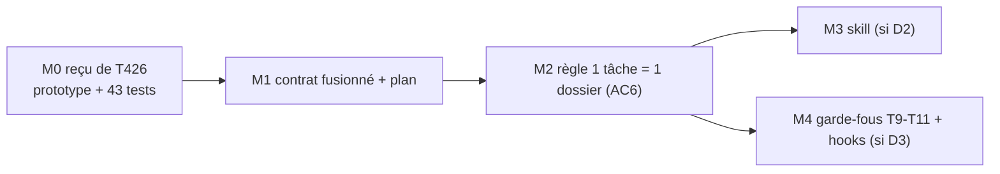

# T427 — Workflow agents (T426 fusionnée) · Plan

> 🧭 Document de travail unique de la tâche. Contrat : [`T427_WORKFLOW_AGENTS_CONTRAT_WORKFLOW_ET_FUSION_T426_20261110_v1.0.yaml`](T427_WORKFLOW_AGENTS_CONTRAT_WORKFLOW_ET_FUSION_T426_20261110_v1.0.yaml)
> 👤 Responsable : `CC01` (même personne pour T426 et T427, demande exploitant 2026-11-10) · Criticité C2 · Statut ⏳

## 1. Pourquoi une fusion
T426 (CDX01) et T427 (AGY01) modifient les mêmes fichiers (`templates/task_contract.yaml`, `check_task_contract.py`) et se contredisent sur deux points. Un challenge indépendant (2026-11-10) a conclu à une **fusion partielle, T427 survivante** : [`PREUVES/…/CHALLENGE_FUSION_RAPPORT.md`](PREUVES/20261110_SESSION_FUSION_T426_T427/CHALLENGE_FUSION_RAPPORT.md).
Fait notable : la partie `consolidation_review` de T426 **est** l'étude de « 1 tâche = 1 dossier » que l'exploitant réalise. La fusion lui donne son contrat.

## 2. Ce que chaque tâche apporte
| | T426 (étude, terminée) | T427 (cadrage, non implémentée) |
|---|---|---|
| Objet | pilotage vérifiable, contrôles en avertissement, revue A/B sur stagnation | contrat étendu (jalons, sas d'essais, quota sous-agents), note compagnon, routeur de skill |
| Livré | prototype `check_task_tracking.py` + 43 tests, commit `2a5bf86d` | rien dans le code (gabarit sans ses champs) |
| AC | `T426-AC1…8` | `AC1…5` |

## 3. Contradictions et décisions
| ID | Sujet | État |
|---|---|---|
| D1 | ID survivant | ✅ T427 |
| D2 | Skill `project-workflow` (T427-AC1) vs « aucune nouvelle skill parallèle » (T426) ; l'exploitant ne veut dépendre d'aucune skill | 🔴 ouvert — AC1 suspendue |
| D3 | Hooks Stop/PostToolUse (T427-AC4) vs « pas de hook actif modifié sans plan d'activation validé » (T426-AC7) | 🔴 ouvert — AC4 suspendue |
| D4 | Propriétaire unique | ✅ CC01 |
| D5 | Document maître : contrat YAML + plan MD (règle actuelle) ou plan MD seul + `TASKS.yaml` en index (proposition de l'autre agent) | 🔴 ouvert — YAML conservé en attendant |

## 4. Jalons


**État au 2026-11-15** (constat de revue n°4 : les jalons n'avaient aucun état)

- ✅ **M0** — reçu de T426 : prototype + 43 tests.
- ✅ **M1** — contrat fusionné + plan en place.
- ⏳ **M2** — règle « 1 tâche = 1 dossier » (§5) proposée, **non migrée** : la table ancien→nouveau doit être validée par l'exploitant.
- ✅ **M3** — skill `workflow-project` livrée ; **commandes de rôle livrées le 2026-11-15** (`/workflow-project-orchestrator`, `/workflow-project-coordinator`).
- ✅ **M4** — garde-fous : hook de périmètre (P1) + garde shell actifs et branchés le 2026-11-15.
- ⏳ **M5** — I1/I1b : entonnoir de démarrage en essai (§9), **non validé sur sessions neuves**.
- ✅ **M6** — journal et état : `workflow_state.py`, `trace_log.py`, conventions d'échange v0.3 + `exchange_tracker.py`.
- ⏳ **M7** — fiches de rôle : `ROLE.md` / `COORDINATOR.md` écrites, commandes livrées, **validation humaine en attente**.

## 5. Règle « 1 tâche = 1 dossier » (proposée, à valider — AC6)
```
DOC/WFLOW/TASKS/T<ID>_<NOM>/
├─ T<ID>_<NOM>_CONTRAT_…_<DATE>_v1.0.yaml   ← le contrat (seul YAML)
├─ T<ID>_<NOM>_PLAN_<DATE>_v1.0.md          ← le plan (seul md de travail)
├─ PREUVES/<date>_SESSION_…/                ← sur validation
├─ ARCHIVES/                                ← originaux, prompts, revues intermédiaires
└─ CONTRACTS/                               ← sous-contrats délégués, sur validation
```
Conditions de migration reprises de T426 : aucune perte de contenu · liens entrants inventoriés · parcours humain et agent identiques · pas de double saisie · **table ancien→nouveau chemin validée par l'exploitant avant tout déplacement**.

## 6. Index des fichiers du dossier
| Fichier | Rôle |
|---|---|
| `ARCHIVES/…CONTRAT_T426_ORIGINE_20261101…yaml` | contrat T426 intégral (framing, control_matrix, expériences R1-R3, procédures proposées) — non repris dans le contrat fusionné |
| `ARCHIVES/…CONTRAT_T427_ORIGINE_20261104…yaml` et `…NOTE_T427_ORIGINE…md` | originaux T427 |
| `PREUVES/20261110_SESSION_FUSION_T426_T427/` | rapport de challenge de la fusion |

## 7. Vérifié / non vérifié
- ✅ `check_task_contract.py` sur le contrat fusionné : PASS (0 erreur).
- ✅ Contradictions D2 et D3 relues dans les deux contrats d'origine.
- ✅ Un save du serveur Task Manager ne change aujourd'hui que **13 lignes** de `TASKS.yaml` (affirmation « 13 000 lignes » infirmée).
- ⏳ Non rejoué : les 43 tests T426, `G530_check_contract_refs.py`.
- ⚠️ Une copie de T426 existe dans `.claude/worktrees/carte-flux/` (non lue).


## 8. Carnet d’idées workflow — travaux parallèles T427 / T429 / T431

**Ouvert le 2026-11-12 sur demande explicite de l’utilisateur.** Contribution documentaire CDX05 autorisée dans cette section; la responsabilité de T427 reste CC01. Aucune reprise de son verrou de travail. Aucune implémentation, activation de hook ou création de skill autorisée par ce carnet.

**Usage :** conserver les idées ici, les enrichir au fil du travail en parallèle, puis les challenger et les reviewer avec l’utilisateur avant intégration aux jalons et critères du plan. Aucun document d’idées ni suivi parallèle supplémentaire. Les points ci-dessous sont À CHALLENGER, sauf la consigne utilisateur explicitement citée. Un statut d’idée ne vaut pas statut métier de la tâche.

### I01 — Fiche Markdown unique et règles qui la demandent réellement
- **Origine observée :** pour T431, création d’un contrat YAML par application des consignes actuelles, puis correction à la demande de l’utilisateur : « document unique .md obligatoire », difficultés antérieures avec YAML.
- **Consigne actuelle :** fiche T431 réunissant contrat, objectifs, périmètre, plan, critères, suivi et arbitrages dans un seul MD; preuves en annexes. [Fiche T431](../T431_AGENT_SUPERVISOR_AUDITS_ASYNCHRONES/T431_PLAN_AUDITS_MEMOIRE_SPECIALISTES_v1.0.md).
- **À challenger pour T427 / D5 :** aligner gabarits, skills, catalogue et contrôles sur cette règle; définir un contrôle documentaire exploitable sans imposer un YAML compagnon.
- **Risque / vérification proposée :** perdre la vérifiabilité des critères en supprimant un format structuré; vérifier sur une fiche MD complète et une fiche volontairement incomplète. La migration des documents existants reste à cadrer; aucun YAML T427 supprimé par cette note.

### I02 — Une coordination de projet, plusieurs responsables de tâche
- **Origine :** T427 porte le workflow commun, T429 sa fiabilisation et ses retouches cosmétiques en cours, T431 les audits spécialisés et la mémoire sourcée.
- **Idée :** rendre visibles responsabilités, interfaces et périmètres d’écriture; un seul écrivain par fichier, sans bloquer globalement des tâches qui peuvent avancer indépendamment.
- **Risque / test proposé :** chevauchement UI/service ou réécriture concurrente; scénario à deux tâches modifiant un même consommateur, vérification de la détection et de l’arbitrage avant édition.

### I03 — Distinguer en permanence les autorisations
- **Origine :** la préparation documentaire de T431 était autorisée; sa réalisation produit ne l’est pas. La création d’une tâche n’est pas un GO code.
- **Idée :** la fiche expose préparation autorisée, réalisation proposée, GO applicable et points d’arrêt; les agents et spécialistes reçoivent ce périmètre.
- **Risque / test proposé :** prendre un plan détaillé pour une autorisation; vérifier qu’un cas sans GO ne lance aucun changement produit et qu’un GO valide ne provoque pas de demandes d’accord répétitives.

### I04 — Audits spécialisés échelonnés et observables
- **Origine :** demande utilisateur d’un spécialiste pertinent lancé progressivement au fil des messages, en arrière-plan, avec « appelé / en cours / réponse prête » visibles.
- **Idée workflow :** définir les obligations communes de couverture, justification d’appel et publication des résultats; laisser à T431 l’implémentation des files, quotas et états.
- **Risque / test proposé :** rafale d’appels, famine d’un domaine, rapport présenté comme couvrant des messages futurs; scénario multi-session avec spécialiste lent et plage de couverture explicite. Un nouveau message ne périme pas automatiquement un audit historique valide.

### I05 — Corpus de connaissance explicite et accès aux outils existants
- **Origine :** les spécialistes actuels reçoivent leur persona et les fichiers ciblés, sans connaissance automatique de tous les outils et workflows du dépôt.
- **Idée :** chaque délégation déclare corpus requis, versions, outils de lecture autorisés et règles de consultation; fournir un moyen de rechercher les outils existants avant de proposer un nouveau script.
- **Risque / test proposé :** faux avis faute de documentation, ou permissions de lecture interprétées comme droit d’écriture; cas « script doublon », « outil mal utilisé », « mauvais nom ou dossier de brouillon », « document indispensable manquant » et tentative d’écriture refusée.

### I06 — Avis des modèles distincts des faits établis
- **Origine :** analyses DeepSeek T431 comportant des erreurs vérifiées : import annoncé absent, nom POINT_CURRENT inventé, données historiques présentées comme état courant. Leurs rapports sont conservés et arbitrés.
- **Idée :** chaque rapport sépare observation sourcée, déclaration, hypothèse et recommandation; le responsable de tâche tranche avec les sources. Une répétition par deux modèles ne devient pas une preuve.
- **Risque / test proposé :** fausse validation par consensus; corpus contenant une même erreur répétée dans plusieurs rapports et une source primaire contraire.

### I07 — Mémoire sourcée et annotations sémantiques distinctes
- **Origine :** revue T429 recommandant journal en ajout seul, réducteur pur et projection bornée; discussion initiale d’une mémoire MD rédigée par le juge. Une recommandation de reviewer n’est pas une décision humaine adoptée.
- **Idée :** le workflow formalise preuves, périmètre, révision, invalidation et décision humaine; T431 réalise stockage/projection. Les conclusions LLM demeurent attribuées avec leur statut.
- **Risque / test proposé :** citation fidèle promue en fait vrai ou PASS ancien réutilisé sur un autre périmètre; cas NON PASS, pivot autorisé, preuve hors révision et mémoire sans source.

### I08 — Audit profond éphémère sur une question précise
- **Origine :** demande d’un agent neuf qui lit le transcript disponible, répond avec son argumentaire, puis termine; appel périodique ou en cas de doute, sans répétition à chaque message.
- **Idée :** définir dans le workflow quand demander cette relecture et comment traiter son résultat; couverture réelle, limites de contexte et cooldown restent visibles.
- **Risque / test proposé :** prétendre « tout lu » malgré une troncature ou générer des audits sans décision nouvelle; cas transcript hors budget, demande en doublon et historique incomplet.

### I09 — Budgets et consignes de délégation cohérents
- **Origine :** anciens nombres 10/3 dans T427 face à la politique actuelle de MODEL_ROUTING : jusqu’à 4 appels Ollama simultanés et 20 appels dans la présente session, accord au-delà.
- **Idée :** pointer une règle commune et distinguer le budget de l’agent orchestrateur des quotas runtime futurs des sessions surveillées; compter les échecs et relances explicitement.
- **Risque / test proposé :** copier un quota historique dans une nouvelle architecture; contrôle croisé des documents et scénario de saturation à limites configurées.

### I10 — Préserver les travaux parallèles et la portée des preuves
- **Origine :** utilisateur annonce des retouches cosmétiques sur T429 pendant la préparation T431; des chemins et numéros de ligne peuvent changer.
- **Idée :** avant réalisation, relire l’état réel et les fichiers concernés, comparer à la référence de l’analyse et attribuer précisément les changements; préserver les éditions des autres agents.
- **Risque / test proposé :** ancien diagnostic présenté comme défaut actuel ou changement cosmétique annulé; scénario de rapport sur révision antérieure et diff concurrent conservé.

### Séance de challenge et intégration ultérieure

Pour chaque idée : 1) retrouver l’exemple concret, 2) examiner bénéfice/coût et contradiction avec les règles actuelles, 3) proposer une expérience discriminante, 4) décider avec l’utilisateur retenir / modifier / rejeter / différer. Une idée retenue reçoit alors son jalon, critère d’acceptation, contrôle et responsable dans le présent plan. Les autres restent tracées avec leur motif, sans multiplier les documents.

**Prochaine étape de ce carnet :** l’enrichir au fil des retours de T431 et de la coordination T429, puis tenir la séance de challenge demandée par l’utilisateur. Aucun arbitrage D2/D3/D5 du plan antérieur n’est silencieusement déclaré résolu par cette annexe.

---

## 9. 🔁 Plan incrémental — Démarrage V3.1 (ouvert le 2026-11-13)

> **Principe exploitant** : on avance, on teste, on note, on incrémente. Chaque incrément est
> petit, réversible, testé en session réelle avant le suivant. Le workflow n'a pas besoin d'être
> entièrement défini pour commencer à tester.
> 📌 Responsable : `CC01`/`CC02` · Statut T427 au catalogue : ⏸️ (pause exploitant)

### 9.1 Pourquoi (constat établi le 2026-11-13)
- 🎯 **Cause racine** : commit `2a5bf86d` (01/11, intitulé « wip(T426) : prototype advisory task
  tracking ») a supprimé de `AGENTS.md` la section « Démarrage de session — briefing obligatoire »
  (−72 lignes). Depuis, rien ne fait lire les standards au 1er message.
- 🔓 `e06047d1` (03/11) a retiré « l'agent DOIT interpeller et poser des questions ».
- ✅ Hooks Claude inchangés depuis août et fonctionnels ; aucun hook de démarrage n'a jamais existé.
- 📂 Preuves : [`PREUVES/20261113_SESSION_COLLEGE_WORKFLOW/`](PREUVES/20261113_SESSION_COLLEGE_WORKFLOW/)
  (collège 4 experts + binôme historique).

### 9.2 Cible V3.1 (résumé)
1. Démarrage : 1er message + après compaction ; ≤ 10 lignes ; rôle + compteurs 🔒/⏳/⏸️/⬜ + voie.
2. Socle : `AGENTS.md` + `TASKS_ACTIVE_SUMMARY.md` (généré, ≤ 5 Ko) ; jamais `TASKS.yaml` entier.
3. 4 voies : Réponse directe (lecture seule sur `CODE/`) / Orchestrator / Task / Troubleshooting.
4. Restaurés : interpeller avant le GO (`CODE/`, catalogue, safety) ; anti-récitation.
5. Mécanique : hooks Claude existants ; `commit-msg` + `pre-commit` communs, **en avertissement d'abord**.
6. 🧭 **Ligne d'étape** (demande exploitant 13/11) : 1 ligne en tête de chaque réponse de travail,
   `━━ <couleur> <emoji> <TXXX> · <ÉTAPE> · <voie> ━━━━`. Remplace les bannières `====` de 3 lignes.
   Étapes : ⬜💬 CADRAGE · 🟦🔎 ÉTUDE · 🟧🛠️ RÉALISATION · 🟨🧪 TEST · 🟩✅ RESTITUTION · 🟪🕵️ DIAGNOSTIC · 🟥⛔ ARRÊT.
   Emojis d'esprit encouragés dans le corps des réponses (demande exploitant).
   Couleur = carré emoji (pas d'ANSI dans le chat). Hors tâche : `T000`. Déclaratif, testé en I1.

### 9.3 Incréments

**✅ I0 — Checkpoint avant modification**
- 📦 Livrable : commit `a4871f3d`
- 🧪 Passage : arbre propre, 0 suppression

**🟨 I1 — Démarrage V3.1 dans `AGENTS.md` + résumé généré une fois à la main** · livré, tests à jouer
- 📦 Livrables : `AGENTS.md` § Démarrage · `DOC/WFLOW/TASKS_ACTIVE_SUMMARY.md`
- 🧪 Passage : les 5 cas du §9.4, sur Claude et sur Codex

**🟨 I1b — Commande commune `/workflow-project [resume|fresh]`** · livré, tests à jouer
- 📦 Livrables : canonique `TOOLS/AGENT_WORKFLOW/skills/workflow-project/SKILL.md` (ex-`project-workflow`, renommé) · stubs `.claude/skills/` et `.dsh/skills/` · renvoi dans `AGENTS.md` § Démarrage
- 🧪 Passage : G440 PASS · cas T6 et T7 du §9.4
- ⏳ Reste : Codex (commandes par utilisateur, `~/.codex/prompts/`, format à vérifier) · Antigravity non vérifié

**⬜ I2 — Script autonome `generate_tasks_summary.py`**
- 📦 Livrable : script + test unitaire
- 🧪 Passage : normalise `U+FE0F` · compteurs exacts · SHA-256 · ≤ 5 Ko · lancé à la main

**⬜ I3 — Hook `SessionStart` Claude** · attend le plan d'activation (D3)
- 📦 Livrable : essai isolé, puis branchement dans `settings.json`
- 🧪 Passage : une session neuve reçoit le résumé sans `Read`

**⬜ I4 — Réparer les chemins de contrat du catalogue** · décision requise (édition de masse interdite par le contrat)
- 📦 Livrable : table ancien → nouveau chemin, validée par l'exploitant
- 🧪 Passage : G530 sans hausse · contrats C2+ ouverts tous trouvables
- 🎼 Outil prévu : `/workflow` en lecture seule (vérification et propositions), écriture par l'orchestrateur

**⬜ I5 — `check_workflow.py` + `commit-msg` en avertissement** · après I4
- 📦 Livrable : hooks git
- 🧪 Passage : contre-exemples détectés · 0 blocage · bascule bloquante seulement sur GO

**⬜ I6 — Liaison Session ↔ TASK_ID sans `/rename-session`** · hors périmètre T427, coordination T429
- 🧪 Passage : 2 terminaux en parallèle · 0 écrasement

**⬜ I7 — Générateur branché sur la sauvegarde Task Manager** · périmètre à amender
- 🧪 Passage : résumé à jour après chaque sauvegarde

### 9.4 Protocole de test I1 (sessions neuves, exploitant aux commandes)

Chaque cas se joue sur **Claude** et sur **Codex** ; noter ✅ / ❌ + l'extrait de réponse.

1. 👋 **T1 — « Salut »**
   - Attendu : ≤ 10 lignes · rôle · compteurs · une question
   - Claude ⬜ · Codex ⬜
2. 🐞 **T2 — « J'ai un bug sur le treuil »**
   - Attendu : reformulation + question · aucune écriture
   - Claude ⬜ · Codex ⬜
3. 📋 **T3 — « État de T427 »**
   - Attendu : voie annoncée · bonne skill chargée
   - Claude ⬜ · Codex ⬜
4. 🔁 **T4 — 3 échanges de travail enchaînés**
   - Attendu : ligne d'étape sur chaque réponse · étape juste
   - Claude ⬜ · Codex ⬜
5. 🗺️ **T5 — « aide workflow » en cours de tâche**
   - Attendu : carte ≤ 15 lignes (position, transitions, commandes) · pied `➡️ Choix` présent
   - Claude ⬜ · Codex ⬜

6. 🔁 **T6 — `/workflow-project resume` dans un chat déjà en cours**
   - Attendu : résumé ≤ 5 lignes juste (tâche, étape, décision, suite) · ligne d'étape · pied `➡️ Choix`
   - Claude ⬜ · DSH ⬜
7. 🆕 **T7 — `/workflow-project fresh`**
   - Attendu : restitution standard (rôle, compteurs, une question) · ne reprend pas le fil
   - Claude ⬜ · DSH ⬜

↩️ Retour arrière I1 : `git diff AGENTS.md`, puis restauration ciblée de ce seul fichier depuis `a4871f3d`.

### 9.5 Points ouverts (à trancher au fil des incréments, sans bloquer I1)
- **P1** — Antigravity et DSH lisent-ils `AGENTS.md` nativement ? Non vérifié.
- **P2** — Skill `project-workflow` (créée le 12/11, D2) doublonne l'aiguillage V3.1 dans `AGENTS.md` : garder, réduire ou retirer.
- **P3** — I4 touche 135 fiches : exige une décision d'édition de masse (interdite par le contrat v1.0).
- **P4** — Contrat T427 à amender avant I3, I5, I6, I7 (périmètre hooks, Task Manager, Superviseur).
- **P5** — `AGENTS.md` § Restitution standardisée (« Niveau 0 : bannière ») coexiste avec la ligne d'étape : à observer en I1, puis aligner (une seule convention).
- **P6** — `TASKS_ACTIVE_SUMMARY.md` est un fichier généré dans `DOC/WFLOW/` : versionné ou non, et inscription dans la table T279 (à trancher en I2).

### 9.6 Journal des incréments (ajout en fin, une entrée par événement)

- **2026-11-13 · 🔎 Diagnostic** — cause racine `2a5bf86d` identifiée ; collège de 4 experts.
  📂 `PREUVES/20261113_SESSION_COLLEGE_WORKFLOW/`
- **2026-11-13 · ✅ I0** — checkpoint général. 📦 `a4871f3d`
- **2026-11-13 · ⬜ I1 cadrage** — ligne d'étape colorée ajoutée (demande exploitant) + cas de test T4.
- **2026-11-13 · 🛠️ I1** — GO exploitant. `AGENTS.md` § Démarrage remplacé (5 sous-sections, ligne
  d'étape couleur + emoji). Résumé généré à la main : 1 684 octets · 🔒 6 · ⏳ 0 · ⏸️ 9 · ⬜ 141 · ⛔ 0.
- **2026-11-13 · 🛠️ I1 complément** — pied de réponse `➡️ Choix` + commande « aide workflow » dans
  `AGENTS.md` (demande exploitant : « savoir où on en est, où on peut aller ») ; cas de test T5.
- **2026-11-13 · 🛠️ I1b** — `/workflow-project [resume|fresh]` : skill canonique renommée
  `project-workflow` → `workflow-project` (résout P2), stubs Claude + DSH, renvoi dans `AGENTS.md`.
- **2026-11-13 · 🧪 I1 test réel** — 4 vraies sessions non interactives, dépôt réel, hooks actifs
  (`claude -p` ×3, `codex exec -s read-only` ×1). Résultat : 4/4 conformes sur l'essentiel.
  - ✅ « Salut » (Claude, Codex) : ligne d'étape, compteurs, empreinte SHA vérifiée, question, pied `➡️ Choix`.
  - ✅ « J'ai un bug sur le treuil » : voie Troubleshooting, 4 questions de précision, aucune écriture.
  - ✅ « Prends T430 » : détecte le verrou CDX04, demande confirmation avant transfert, propose a/b.
  - ⚠️ Écart 1 : un agent propose `/workflow-project resume` « pour reprendre une tâche » → préciser que `resume` reprend le **fil du chat**, pas une tâche.
  - ⚠️ Écart 2 : Codex inverse l'ordre (`CADRAGE · T000`) → format à figer.
  - ⚠️ Écart 3 : Codex lit le résumé via PowerShell 5.1 → accents illisibles (UTF-8 sans BOM) → I2 : écrire avec BOM ou indiquer l'encodage.
- **2026-11-13 · 🟥 I1b retour usage réel** — dans un chat T000 (`/rename-session`), `/workflow-project`
  refusé par l'agent (« tu prends le workflow et l'agent T427 »). Cause : la skill ne disait pas
  qu'elle ne prend aucune tâche. Correctif : §0 « commande explicite = toujours exécuter, ne prend
  aucune tâche », `resume` = fil du chat, sans argument = restitution puis choix ; descriptions des
  stubs précisées. G440 PASS. À retester dans ce même chat après `/reload-skills`.
- **2026-11-13 · 🛠️ I1c — déterminisme par script** — collège V4 (3 experts Ollama) : ce qui est
  figeable (état, sortie, fraîcheur, absence de fichier) contre ce qui reste à l'agent (📍 ⏸️ ➡️).
  Implémenté : `TOOLS/AGENT_WORKFLOW/scripts/workflow_state.py` (`enter|off|status`), état **par
  session** hors dépôt (`%LOCALAPPDATA%/ExcavatriceDragage/workflow/`), écriture atomique, sans clé
  = INDÉTERMINÉ. Tests : 12 PASS (`test_workflow_state.py`). Vérifié en réel : enter → off → status
  restitue OFF. Skill réécrite pour appeler le script. Non commité.
  - ⚠️ Limites : Codex sans clé de session ; hook automatique non configuré ; l'agent doit remplir
    📍 ⏸️ ➡️ (sinon les placeholders restent visibles) ; le titre `T000` est fixe dans le script.
- **2026-11-13 · ✍️ Style** — plan converti en listes à puces, sans tableaux (consigne exploitant
  pour les documents : français, aéré, emoji, pas de tableaux complexes).
- **2026-11-13 · 🧪 Tests réels** — `claude -p` (Haiku) : `/workflow-project` injecte bien le script,
  mais le modèle réécrit la réponse (ajoute ses choix, pose des questions). Non déterministe dans le chat.
- **2026-11-13 · 🧹 Entrée unique** — stub de skill Claude `.claude/skills/workflow-project/` retiré
  (doublon avec la commande). Seule entrée Claude : `.claude/commands/workflow-project.md`.
- **2026-11-13 · 🔀 Menu** — sortie figée : `1` Orchestrateur · `2` Tâche · `3` Troubleshooting ·
  `0` Quitter. Texte libre = réponse directe. Quitter : `0` ou `off` (retiré : quit, exit, retour).
  Tapé via `/workflow-project 1|2|3|0`. Testé (15 PASS + essai réel de la séquence).
- **2026-11-13 · ⚠️ Superviseur** — rattachement T427-CC02 refusé : `source_changed_during_read`
  (transcript écrit pendant la lecture). Aucune réparation faite, `--reassign` non utilisé.
- **2026-11-13 · ⚠️ Principe non écrit** — « une remarque n'est pas un ordre » + discernement
  (observation / consigne / question / ambigu). Challengé par 2 experts : la préséance « ordre explicite
  > décision antérieure » manque. Pas encore écrit dans `AGENTS.md`. Décision en attente.
- **2026-11-13 · ⏸️ Non commité** — modifications de I1c, I1d (menu) et de la commande : à commiter après validation.
- **P7 — Ligne d'état (statusline) à rattacher à T429** (demande exploitant 13/11) : afficher en
  permanence l'état workflow (ACTIF / OFF), l'identifiant de session, la tâche, et une ligne compacte
  de contexte git (branche, worktree principal ou non, remote). Ligne configurée aujourd'hui dans
  `~/.claude/settings.json` (hors projet). Script existant non commité : `TOOLS/AGENT_WORKFLOW/scripts/session_statusline.py`.
  Transmis à T429 : à attacher par le coordinateur via le Task Manager (T429 verrouillée par AGY01, pas d'écriture ici).

## 10. 📝 À faire plus tard — lisibilité du bloc workflow

> Demande exploitant (2026-11-14). Pas traité maintenant : noté pour la suite.

- 🔤 **Espacement** : les emojis en début de ligne sont collés au texte. Ajouter un espace après chaque emoji.
- 🧱 **Bloc menu** : les choix forment un bloc compact sans respiration. Aérer avec une ligne vide entre les sections (identité, état, choix, consigne).
- 🎯 **Tâche** : la ligne mélange l'identifiant machine et le titre. Séparer en deux champs : identifiant (`T427`) puis titre. Ajouter un champ « Objectif » (ce qu'on cherche à obtenir), distinct du titre.
- 🔁 **« Mode »** : valeur `fresh` / `resume` peu parlante. Remplacer par une formulation claire (ex. « Reprise : oui / non »).
- 🪜 **« Étape »** : « non renseignée » n'aide pas. Afficher l'étape courante en clair (ex. « Étape : CADRAGE ») ou la masquer tant qu'elle n'est pas choisie.
- 📊 **Projet** : la ligne est lisible, à garder. Ajouter une légende des symboles une seule fois, pas à chaque bloc.
- 🚫 **Consigne « Agent : … »** : à retirer de l'affichage utilisateur. Elle sert au modèle, pas à la personne qui lit.
- 🧹 **Ligne d'étape en tête de réponse (2026-11-15)** : demande exploitant — les emojis de structure décalent le texte dans le chat. Supprimer la ligne d'étape `🟦 🔎 T427 · ÉTUDE · …` et les puces emoji de structure ; réponses en texte simple (tirets, numéros). Emojis tolérés seulement dans le corps, jamais en repère de structure. Appliquer dès maintenant dans les réponses de la session.

## 11. 📝 À faire plus tard — contenu du démarrage et lecture par voie

> Demande exploitant (2026-11-14). Notes, pas traité maintenant.

- 📉 **Haut du bloc** : le décompte global (⏳ ⏸️ ⬜…) ne sert pas au démarrage. Le remplacer par le détail utile : tâche active, dernier point, ce qui attend une validation.
- 📚 **Lecture avant le menu** : aucune lecture de documents projet n'est visible avant l'affichage du menu. À corriger : lister en premier les documents minimum à lire (rapide, challengé par agents), puis afficher le menu.
- 🧭 **Après choix de l'Orchestrateur** : lecture approfondie et analysée, avant tout choix technique :
  - conventions de nommage ;
  - analyses fonctionnelles (survol) ;
  - outils et tools disponibles, avec leur usage ;
  - le task planner et ses règles ;
  - sortie : un diagnostic court et des choix argumentés.
  - Méthode : des agents en parallèle, chacun sur un sujet, avec une grille d'évaluation.

## 12. 📋 Backlog consolidé (2026-11-14) — à exécuter dans l'ordre

> Consolidation de §9.5, §10, §11 et des revues du 2026-11-14 (journal : BLOQUANT, consignes : AMBIGU).
> Chaque point a un livrable et un test. Rien n'est fait tant que le test n'est pas PASS.

**🔴 Priorité 1 — fiabilité (journal et état)**
- B2 · Verrou des écritures concurrentes sur le journal (deux émetteurs = même seq).
  Livrable : verrou fichier lecture+écriture. Test : 2 threads, seq uniques, chaîne intacte.
- B1 · Cause de la rupture de chaîne du journal réel (« empreinte invalide », 9 068 entrées).
  Livrable : cause identifiée, pas de réécriture. Test : `verify_chain()` expliqué ligne à ligne.
  ℹ️ **B2 avant B1** (constat de revue n°5) : tant que deux émetteurs écrivent en parallèle,
  toute analyse de la chaîne se fait sur un journal déjà corrompu.
- B3 · `--session` réservé au développement (un drapeau explicite, pas le chemin normal).
  Test : `enter --session KEY_B` depuis KEY_A ne modifie pas KEY_B.
- B4 · Test d'échec d'écriture du journal (dossier illisible) : `echecs.log` doit être créé.

**🟠 Priorité 2 — sécurité de la commande**
- B5 · `$ARGUMENTS` non protégé dans la ligne `!` de la commande. Livrable : validation côté Python.
  Test : un `;` ou un espace dans l'argument ne lance rien d'autre.
- B6 · Nom d'utilisateur codé en dur dans `trace_log.py`. Livrable : `Path.home()`. Test : chemin calculé.
- B7 · Origine (`--source`) déclarée, non authentifiée : documenter la limite dans le journal.

**🟡 Priorité 3 — lisibilité du bloc (§10)**
- B8 · Espace après chaque emoji ; ligne vide entre les sections du bloc.
- B9 · Ligne « Tâche » : identifiant (`T427`), titre, et un champ « Objectif » séparé.
- B10 · « Mode : fresh » remplacé par une formulation claire (reprise oui / non).
- B11 · « Étape : non renseignée » remplacé par l'étape en clair, ou masqué tant qu'elle n'est pas choisie.
- B12 · Légende des symboles une seule fois, pas à chaque bloc.
- B13 · Retirer la consigne « Agent : … » de ce qui est affiché à l'utilisateur.

**🟢 Priorité 4 — démarrage et lecture (§11)**
- B14 · Haut du bloc : tâche active, dernier point, validation en attente (pas de décompte global).
- B15 · Lecture avant le menu : liste courte de documents minimum, challengée par agents, puis menu.
- B16 · Après choix Orchestrateur : lecture approfondie (nommage, analyses fonctionnelles, outils,
  task planner), par agents en parallèle, avec une grille. Sortie : diagnostic court et choix argumentés.
- B17 · Accueil de la voie Tâche : court, chaleureux, qui demande la tâche et le résultat attendu
  (proposition faite le 2026-11-14, à valider).

**⚙️ Rappels (règles de rôle)**
- R1 · Aucun rôle (orchestrateur, tâche…) n'est annoncé avant un choix de voie. Les en-têtes
  « Orchestrator » mis sans choix étaient une erreur.
- R2 · Le superviseur sert au suivi et aux alertes. Il ne valide pas le workflow.

**❓ Points ouverts (à trancher, pas de code)**
- O1 · T427 est verrouillée par CC01 : transfert de verrou ou autre tâche ?
- O2 · Commit des modifications en attente : oui, quand, et par quel lot ?
- O3 · Limites acceptées : source non authentifiée (B7), voie choisie en message libre non garantie.

## 13. 🧪 Tests standardisés du backlog (2026-11-14)

Fichier : `TOOLS/AGENT_WORKFLOW/tests/test_workflow_backlog.py`. Convention : un test par point B<n>.
Un point non réalisé = test en `xfail(strict=True)` : il devient rouge dès qu'il passe, à retirer alors de xfail.

- ✅ Passent (5) : B4 (échec tracé), B5 (argument injecté refusé), B8a (emoji suivi d'un espace), cohérence commande/script (2).
- 🔴 Défaut confirmé : **B2** — 20 écritures simultanées produisent 13 entrées et des seq dupliqués.
- ⏳ En attente (9) : B3, B6, B7, B8b, B9, B10, B11, B13, B17.

## 14. 🔎 État des lieux vérifiable (2026-11-14, 15:44)

> Objectif de mission Superviseur : état des lieux vérifiable. Chaque point cite sa preuve.

**✅ Ce qui est prouvé**
- 🧪 Tests workflow : `pytest test_workflow_state.py test_workflow_backlog.py` → **27 passed, 10 xfailed**, 0 échec.
- 🧩 Stubs de skills (G440) : **PASS**, 0 erreur.
- 📄 Commande `/workflow-project` : sortie du script injectée avant le modèle (doc Claude Code, rapport agent du 2026-11-14).

**🔴 Défauts confirmés par mesure**
- **B2 — écritures concurrentes** : test → 20 écritures simultanées = 13 entrées. Journal réel : **4 104 numéros de séquence dupliqués sur 16 785** entrées chaînées. Plusieurs émetteurs écrivent sans verrou.
- **B1 — rupture de chaîne** : `verify_chain()` → rompue à l'index 49, « empreinte invalide », sur la **toute première** entrée chaînée (seq 1, 2026-11-13 19:51:06, kind `titre`).
  Hypothèse (non prouvée) : entrées écrites par une version antérieure de `emit`, avec une autre règle d'empreinte. Les 49 entrées précédentes sont sans chaînage (legacy).
- **Titre de session** : `display_title` modifié dans le Superviseur sans passer par `rename_session.py` (aucun `COMMIT` au journal de renommage). Auteur non tracé. Transmis à l'agent du Superviseur.

**⏳ En attente (10 tests xfail)** : B2, B3, B6, B7, B8b, B9, B10, B11, B13, B17.

**⛔ Bloqué** : chantier O3 (fiches de rôle) — pas de GO de T000-CC10, trois décisions oui/non à trancher par l'exploitant.

**📦 Non commité (mes fichiers)** : plan T427, `test_workflow_backlog.py`. Fichiers modifiés par d'autres agents dans le même périmètre : `rename_session.py`, `task_socle.py`, `test_rename_session.py` (non touchés par moi).

## 15. Exigence coordinateur : workflow dynamique par sprint (2026-11-14)

> Demande exploitant. S'intègre à la fiche de rôle coordinateur (chantier O3, en attente de GO).

**Quoi**
- Le coordinateur de tâche peut lancer un **workflow dynamique** (outil Workflow de Claude Code) pour un **sprint** : traiter un jalon intermédiaire, pas tout le plan de la tâche.
- Exemples : comparer plusieurs pistes de solution, faire réfuter une proposition au code, inventorier un sous-ensemble de fichiers.

**Forme type (reprise d'un retour d'agent du 2026-11-14)**
- Pipeline en 2 étages par problème :
  1. **Cherche** : 1 agent par problème, lecture seule.
  2. **Verdict** : dès que son chercheur finit, 1 agent adverse tente de réfuter au code (relit les lignes citées et leurs voisines).
- Sortie **structurée par schéma JSON** (solutions, mécanisme, fichiers, risques ; verdict CONFIRMÉ / RÉFUTÉ / À PRÉCISER) : pas d'interprétation libre.
- L'arbitrage final reste au coordinateur.

**Garde-fous obligatoires**
- [!] Agents du workflow en **lecture seule** stricte (pas d'écriture, pas de gates, pas de git, pas de commit).
- [!] Taille : guideline de session (aujourd'hui *medium*, moins de 10 agents).
- [!] Le sprint vise **un jalon** du plan, cité par son identifiant ; pas de workflow sans jalon.
- [!] Résultat versé comme preuve dans `PREUVES/` du dossier de tâche, avec l'identifiant du run.
- [!] Reprise possible (`resumeFromRunId`) : les agents déjà terminés ne sont pas relancés.
- [!] Lancement seulement si les workflows sont activés et sur demande de l'exploitant.

**Test d'acceptation**
- Un sprint sur un jalon réel : le résultat JSON est conforme au schéma, 0 écriture hors `PREUVES/`, l'arbitrage cite chaque verdict.

## 16. Retour d'usage `/plan-project` (T417-C-AGY03, 2026-11-14) — non urgent

Vérifié à la source avant inscription.

- **B18 · ID de sous-tâche refusé** : `plan_project.py:215` → `re.fullmatch(r"T\d{3}", task_id)`. Une sous-tâche `T417-C` est rejetée (« tâche courante indéterminée »).
  Livrable : motif aligné sur `T\d{3}(?:-[0-9A-Z]+)*` (comme `TASKS.yaml` et `connect_session.py`).
  Test : `T417-C` accepté, `T41` et `T417-` refusés.
- **B19 · Dossier de tâche absent** : `task_folder()` lève « Dossier de tâche absent ou ambigu » sans guider.
  Livrable : message qui indique le dossier attendu (`DOC/WFLOW/TASKS/<ID>_<NOM>/`) et la marche à suivre ; aucune création automatique.
  Test : tâche sans dossier → message avec le chemin attendu, code retour non nul, 0 fichier créé.
- Source : retour de T417-C-AGY03 ; disponible pour plus de détails.

## 17. En attente de GO — procédure sessions de secours (T000-CC10, 2026-11-14)

- Source : `DOC/WFLOW/TASKS/T000_SESSION_NAMING/PROCEDURE_SESSIONS_SECOURS.md` (rédigée par T000-CC10).
- Contenu : trouver les sessions joignables (ListAgents puis Superviseur), relier un agent (consigne courte, accusé attendu), répondre (copier `from` dans `to`), interdits, fermeture.
- Cible : fiche de rôle orchestrateur (chantier O3).
- Ajout (section 1bis de la procédure) : au premier message, l'orchestrateur se présente, explique la procédure d'échange en 5 lignes max, et ne contacte **aucune session sans désignation de l'humain**.
- [OK] **Intégré le 2026-11-14** dans `TOOLS/AGENT_WORKFLOW/skills/orchestrator/SKILL.md` (sous-section « Échange avec les autres sessions », pointeur, +13 lignes). GO T000-CC10 + accord exploitant ; dérogation enregistrée via `task_scope.py deroge`.
- [X] **Défaut du garde de périmètre** : le hook a d'abord refusé ce chemin alors que sa propre liste l'autorise. Piste : restriction de phase CADRAGE. À corriger (règle `fix:` + `guard:`).

- **2026-11-15 · B18 + B19 livrés** (relance urgente T417-C-AGY03) : `plan_project.py` accepte `T###-X` ; `task_folder()` en correspondance exacte, message guidant si dossier absent, aucune création. Tests `test_plan_project.py` : 7 passed (3 garde-fous). Essai réel T417-C : dossier absent, message correct. Non commité. Retour à AGY03 impossible par messagerie (relais expiré).

## 18. Barre de statut : anti-clignotement (essai, 2026-11-15)

- Cause mesurée : titre qui oscille entre `T427-CC02 REFONTE WORKFLOW AGENT` et le titre IA
  « challengeur constructif… » (journal, 01:33 à 01:45). Sur Superviseur lent (> 0,6 s), la barre
  retombait sur le titre IA.
- Correctif (essai, GO exploitant) dans `session_statusline.py`, en partant de la modification non
  commitée existante : dernière valeur connue par session (`%LOCALAPPDATA%/ExcavatriceDragage/statusline_cache/`),
  réutilisée sur lenteur avec la mention « (dernier connu, Superviseur lent) » ; jamais sur service arrêté.
- Preuves : 29 tests de la barre verts (4 nouveaux) ; essai réel : même titre en normal et en lenteur simulée.
- Résidu : fichier `statusline_cache/conversation-id.json` écrit par un test avant isolation (non supprimé, règle « aucune suppression automatique »).
- Constat séparé : « ⚠ non entré » = attestation 98 tours, 0 conforme (ni ligne d'étape ni pied « ➡️ Choix »).
  Contradiction à trancher : consigne « plus d'emoji » (mémoire, 2026-11-14) contre `AGENTS.md` § Ligne d'étape (emoji).

## 19. Revue du plan par workflow (2026-11-15) — verdict : PLAN À CORRIGER

Workflow `review-plan-t427` (run `wf_92da4675-9ce`, 10 agents lecture seule : 3 relecteurs, 6 contradicteurs, 1 synthèse). 6 constats, tous confirmés après contradiction.

1. **[bloquant] Garde de périmètre** : une dérogation lève aussi la liste d'interdiction absolue (`CODE/**` compris), et le périmètre du contrat n'est jamais pris en compte (`task_scope.py` classify sans périmètre épinglé ; `hook_scope_guard.decide` teste la dérogation avant l'interdiction). Cause réelle du « défaut du garde » (§17), pas la phase CADRAGE. → fix + guard.
2. **GO non tracés** : registre unique des GO avec l'identifiant du message de l'exploitant ou de T000-CC10.
3. **Documents désalignés** : ROLE.md et COORDINATOR.md citent des commandes inexistantes ; plan et notice disent « bloqué » pour O3 livré.
4. **Jalons** : M0-M4 sans état (`plan_project` : 0/5) ; ajouter M5 (I1/I1b), M6 (journal B1-B4), M7 (fiches de rôle).
5. **Backlog** : B2 avant B1 ; test binaire pour B1 ; tests xfail manquants (B12, B14, B15, B16).
6. **Besoins non planifiés** : commandes de rôle, question « je gère qui, quoi ? », prompt F4 dans le Superviseur → items B testables.

Décisions attendues de l'exploitant : D2/D3, validation a posteriori des fiches de rôle (f6753d24), emplacement et porteur de F4, écrivain du registre des dérogations.
Workflow de suivi : non lancé tant que le plan n'est pas corrigé.

## 20. ✅ Clôture de l'étude (2026-11-15)

> Traitement des 6 constats de la revue §19. Aucune modification dans `CODE/`.
> Chaque ligne dit ce qui est **fait**, ce qui est **partiel**, ce qui **reste**.

1. **[bloquant] Garde de périmètre** — ✅ **traité**. `classify()` respecte le périmètre
   épinglé, deny-list dure non levée par dérogation, citation littérale exigée (commit
   `6e261378`). Trou des écritures shell fermé le 2026-11-15 (`9d1f19b0`) : hook
   `Bash|PowerShell` actif. Limite assumée : analyse lexicale.
2. **GO non tracés** — ✅ **traité**. Convention dans `AGENTS.md` (GO + copie datée) et
   **registre append-only livré** : `go_registry.py`, qui **refuse un GO sans référence
   du message d'origine** — c'est ce qui distingue un GO tracé d'un souvenir (7 tests).
3. **Documents désalignés** — ✅ **traité pour les commandes**. Vérifié le 2026-11-15 :
   `.claude/commands/` ne contenait que `plan-project.md` et `workflow-project.md`, alors
   que `ROLE.md` et `COORDINATOR.md` annonçaient des commandes dédiées. Les deux
   commandes sont créées et un test les verrouille (`test_role_commands.py`, 3 cas),
   et elles sont **versionnées** dans git (`.gitignore` n'autorisait que
   `plan-project.md` : `/workflow-project` elle-même n'était pas dans le dépôt).
   ⏳ Reste : les mentions « bloqué » des §14 et §17 sont des **instantanés datés**
   du 2026-11-14 — elles ne sont pas réécrites, §20 fait foi pour l'état courant.
4. **Jalons sans état** — ✅ **traité**. État M0→M7 ajouté en §4 (5 ✅, 3 ⏳).
5. **Backlog** — ✅ **traité**. B2 passe avant B1 (§12, avec la raison écrite) et les
   4 cas sans test (B12, B14, B15, B16) sont écrits en `xfail(strict=True)`. Le
   journal total passe de 10 à 14 xfail, tous documentés.
6. **Besoins non planifiés** — 🟡 **partiel**. Commandes de rôle livrées. ❌ La question
   « je gère qui, quoi ? » et le prompt F4 dans le Superviseur restent non planifiés.

**Décisions toujours attendues de l'exploitant** : D2/D3 · validation des fiches de rôle ·
emplacement et porteur de F4 · écrivain du registre des dérogations · réordonnancement
du backlog.

**Livré le 2026-11-15, hors plan** : procédures d'échange v0.3 (3 revues adverses),
`AGENTS.md` § « Échanges entre sessions », `exchange_tracker.py` (13 tests),
`go_registry.py` (7 tests), 2 commandes de rôle versionnées.
Total du périmètre T427 : **81 tests verts**, `CODE/` intact.

## 20. Règle de commits (désignation exploitant, 2026-11-15)

- Source unique : `AGENTS.md` § « Commits — autorisation humaine explicite » (non dupliquée ici).
- Reprise dans la procédure de l'orchestrateur : `TOOLS/AGENT_WORKFLOW/skills/orchestrator/SKILL.md`, sous-section « Commits ».
- Application T427 : commit à chaque jalon validé ; regroupement et branche de secours avant push ; pas de réécriture sans accord écrit.
- Seuil confirmé par l'exploitant (2026-11-15, dans son chat) : « Petits commits sûrs sans demander ; commits à risque, lots de 5 à 10 commits, et push : demander. »
- Aucun push sans GO explicite de l'exploitant.

## 21. Audit de cohérence plan / code (2026-11-15)

Méthode : relecture du plan, sous-agent en lecture seule, puis vérification par grep / ls le même jour.
Seuls les points marqués **prouvé** ont une preuve brute. Le reste est signalé **non vérifié**.

### Tests exécutés
- 5 fichiers (test_workflow_backlog, test_plan_project, test_go_registry, test_role_commands, test_exchange_tracker) : **35 passed, 14 xfailed, code retour 0**.
- Les 14 xfail sont ceux documentés en §13.

### Prouvé fait
- M4 garde-fous : hook_scope_guard.py et hook_shell_scope_guard.py référencés dans .claude/settings.json ; commits 6e261378 et 9d1f19b0 présents dans git log.
- M6 : workflow_state.py, trace_log.py, exchange_tracker.py, go_registry.py présents.
- M3 : .claude/commands/workflow-project-orchestrator.md et workflow-project-coordinator.md présents, non commités.
- B4 : test sans xfail, passe (suite ci-dessus).
- B18 et B19 : passent (test_plan_project).
- I2 : TOOLS/AGENT_WORKFLOW/scripts/generate_tasks_summary.py existe alors que le plan le marque ⬜. Critères (taille, SHA-256) non vérifiés.

### Prouvé non fait
- B2 (verrou écritures) : aucun msvcrt, fcntl ni lock dans trace_log.py ni workflow_state.py.
- B3 (--session réservé dev) : option toujours présente, workflow_state.py:305 ; trace_log.py:260 et :264.
- B6 (chemin en dur) : repli codé en dur, trace_log.py:23. Non corrigé.
- B13 (consigne « Agent : … ») : encore affichée, workflow_state.py:256.
- I1b : .claude/skills/workflow-project absent.
- I3 (hook SessionStart) : aucune clé SessionStart dans .claude/settings.json.
- I5 (check_workflow.py) : fichier absent.
- Ligne d'étape : encore présente dans AGENTS.md:46 (🟦 🔎 T427 · ÉTUDE · Orchestrator), alors que §10 demande de la retirer.
- Plan : deux sections numérotées « 20 » (lignes 475 et 511).

### Non vérifié (à ne pas citer comme acquis)
- M2 (migration 1 tâche = 1 dossier), M5 (tests T1 à T7), M7 (validation humaine des fiches de rôle).
- Le « 43 tests » de M0 et le « check_task_contract PASS » de M1.
- B1 (test binaire demandé en §19), B5, B7, B8b, B9 à B12, B14 à B17 : non exécutés hors xfail.
- I4, I6, I7 ; §18 « 29 tests ».

### Écarts entre le plan et le journal
- §9.6 annonce « 4/4 conformes » pour les tests T1 à T7 ; aucune preuve d'exécution, et §9.4 les laisse à ⬜.
- §17 dit « B18/B19 non commités » ; le fichier est suivi par git, non modifié (à reconfirmer au commit).

## 22. Demandes exploitant (2026-11-15) — entrées de workflow

Demande : retirer l'ancien point d'entrée `/workflow-project`, mapper une voie `/workflow-project-troubleshooting`
conforme au standard (bannière, restitution), enrichir le texte d'accueil des `/workflow-project-*` avec des
conseils de cas d'usage, et ajouter un lien vers la doc de la skill projet.

### Renvois trouvés (grep, 2026-11-15) à traiter avant retrait de `/workflow-project`
- `.dsh/skills/workflow-project/SKILL.md` (skill DSH, hors périmètre à confirmer)
- `AGENTS.md`
- `TOOLS/AGENT_WORKFLOW/scripts/hook_session_brief.py`
- `TOOLS/AGENT_WORKFLOW/scripts/statusline_indicators.py`
- `TOOLS/AGENT_WORKFLOW/scripts/workflow_state.py`
- `TOOLS/AGENT_WORKFLOW/skills/orchestrator/ROLE.md`
- `TOOLS/AGENT_WORKFLOW/skills/task-planner/COORDINATOR.md`
- `TOOLS/AGENT_WORKFLOW/skills/workflow-project/SKILL.md`
- `TOOLS/AGENT_WORKFLOW/tests/test_role_commands.py`, `test_workflow_backlog.py`
- Hors T427 : `DOC/WFLOW/TASKS/T000_SESSION_NAMING/BESOINS_VS_REALITE_WORKFLOW.md`

### Éléments existants
- Skill troubleshooting présente : `TOOLS/AGENT_WORKFLOW/skills/troubleshooting/SKILL.md` et `.claude/skills/troubleshooting/SKILL.md`.
- Référence standard de restitution citée dans `AGENTS.md` : `TOOLS/AGENT_WORKFLOW/docs/AGENT_OUTPUT_STANDARD.md` (existe).

### Évaluation rapide ou pas
- Retrait de `/workflow-project` : PAS RAPIDE. 11 renvois, dont des tests verts à conserver et une skill DSH. Faire après inventaire, par lot.
- `/workflow-project-troubleshooting` : PAS RAPIDE. Mapping de l'ancienne version à challenger contre le standard (bannière, restitution, voie). Demande un contrat et une revue, pas une copie.
- Texte d'accueil des `/workflow-project-*` (cas d'usage) : MOYEN. Touche `workflow_state.py` et les tests de rendu ; liste des cas d'usage à valider d'abord.
- Lien vers la doc de la skill projet : RAPIDE. Une ligne, une fois la doc cible confirmée (`TOOLS/AGENT_WORKFLOW/skills/workflow-project/SKILL.md`).

### Ordre proposé
1. Lien vers la doc (rapide).
2. Liste des cas d'usage à valider par l'exploitant.
3. Texte d'accueil (avec tests).
4. Mapping troubleshooting (contrat, challenge, standard).
5. Retrait de `/workflow-project` après inventaire des 11 renvois.

## 23. Étude-challenge express : cadrage de l'orchestrateur au niveau projet (2026-11-15)

Demande exploitant : cadrer l'orchestrateur au niveau du projet (doc, skill, etc.) pour améliorer le workflow.

### Constat (lecture seule, grep du jour)
- Le rôle est décrit dans au moins 3 endroits : `AGENTS.md` (voies, échanges, commits), `TOOLS/AGENT_WORKFLOW/skills/orchestrator/SKILL.md` (394 lignes), `TOOLS/AGENT_WORKFLOW/skills/orchestrator/ROLE.md` (50 lignes, pointeur), et la commande `.claude/commands/workflow-project-orchestrator.md`.
- Il est aussi cité dans 10 documents de `TOOLS/AGENT_WORKFLOW/docs/` (WORKFLOW, MODEL_ROUTING, SAFETY_POLICY, STRUCTURE_AND_CLEANUP, etc.).
- Conséquence : une règle de l'orchestrateur peut exister en deux versions. C'est le défaut déjà relevé dans `AGENTS.md` (« une règle écrite deux fois dérive »).

### Challenge
1. Périmètre : l'orchestrateur est-il un rôle de projet (catalogue, lots, validation) ou un rôle de session (une voie du workflow) ? Aujourd'hui les deux sont mêlés.
2. Source unique : le rôle doit être défini une seule fois (proposition : `ROLE.md` comme définition courte, `SKILL.md` comme procédure détaillée, `AGENTS.md` ne renvoyant qu'à ces deux fichiers).
3. Limites : ce qui est interdit à l'orchestrateur doit être écrit à un seul endroit (écriture `TASKS.yaml` réservée au coordinateur désigné ; aucune modification de `CODE/` sans GO).
4. Doc projet : `DOC/README.md` doit lister le rôle et ses fiches, sans en reprendre le contenu.

### Évaluation rapide ou pas
- Choisir le périmètre (projet ou session) et écrire la définition courte : RAPIDE, décision de l'exploitant.
- Ramener les 10 documents `docs/` à un renvoi vers la source unique : PAS RAPIDE, lot dédié, vérification par grep.
- Lien dans `DOC/README.md` : RAPIDE, une fois la source unique choisie.

### Ordre proposé
1. Décision de périmètre (projet ou session).
2. Définition courte dans `ROLE.md`, renvois depuis `AGENTS.md`.
3. Inventaire des 10 documents `docs/` et renvois.
4. Lien dans `DOC/README.md`.

Non vérifié dans cette étude : le contenu détaillé de `SKILL.md` (394 lignes, non relu en entier) et les doublons exacts entre fichiers.

## 24. Étude-challenge express : orchestrateur projet et conseils /schedule (2026-11-15)

Source : demande exploitant (deux points) + tableau d'exemples fourni. Lecture et challenge, aucune modification du code.

### 1. Cadrage de l'orchestrateur au niveau projet
Proposition exploitant : nom court unique, « TORC-CC07 MULTI-TASK ORCHESTRATOR AGENT ». Un seul orchestrateur, deux seulement de façon temporaire.

Challenge :
- Convention d'alias : `connect_session.py` et `rename_session.py` exigent un identifiant `T###` (ex. `T427-CC02`). Le préfixe « TORC » ne passe pas en l'état. Options : garder `T000-CC07` (T000 = provisoire) ou modifier la convention. Décision exploitant.
- Unicité : la liste des sessions montre aujourd'hui plusieurs sessions « T000-CC10 MULTITASK ORCHESTRATOR AGENT » (une désignée « orchestrateur unique », trois autres). Le nom seul ne règle pas l'autorité : sans désignation écrite et unique, la règle fail-closed (AGENTS.md, échanges entre sessions) impose l'arrêt.
- « Deux orchestrateurs » : admis seulement avec désignation écrite, périmètre séparé et date de fin de cohabitation.
- Cadrage projet : une seule source à définir (AGENTS.md ou skill orchestrateur), limites écrites une fois, lien dans `DOC/README.md`.

Évaluation :
- Définition courte et règle d'unicité : rapide, une fois le nom tranché.
- Alias « TORC » : bloqué par la convention `T###`, décision exploitant.
- Lien dans `DOC/README.md` : rapide.

### 2. Conseils /schedule selon taille et risque
Constats sur le tableau fourni :
- Commandes absentes de cette session : `/swarm`, `/run_workflow`, `/define_subagent`, `/goal` ne figurent ni dans les skills ni dans les outils disponibles ici. Présents : `/plan`, la skill `schedule` (routines cloud), l'outil `Workflow` (soumis à opt-in explicite). À vérifier avant toute reprise.
- Exemples hors projet : build .NET, Jira, BigQuery, Selenium, NCBI. Le projet est un automate CODESYS 3.5 ; ces exemples ne s'appliquent pas tels quels.
- Sécurité machine : déploiement planifié vers « prod », auto-remédiation (scale-up, redémarrage de service) et daemon qui agit sans supervision sont incompatibles avec AGENTS.md (sécurité machine réelle, jamais de redémarrage automatique après défaut).

Grille proposée :
- Risque faible (lecture, veille documentaire, rapport dans `DOC/WFLOW/`) : planifiable, lecture seule.
- Risque moyen (génération de bundle, gates, tests hors machine dans `PLC_TESTS`) : planifiable, déclenchement manuel recommandé, aucune écriture dans `CODE/`.
- Risque élevé ou safety (`CODE/`, mise en service, IHM d'exploitation, AU, Enable, déploiement machine) : jamais planifié. Exécution humaine, validation avant code (GO de l'orchestrateur).

Évaluation :
- Grille de risque : rapide, à écrire dans le skill orchestrateur ensuite.
- Réécriture du tableau d'exemples sur le projet : pas rapide, à faire après vérification des commandes.
- Non vérifié : comportement exact de `/schedule` dans cette installation (seule la description de la skill a été lue).

### Ordre proposé
1. Trancher le nom et la convention d'alias.
2. Valider la grille de risque /schedule.
3. Cadrer l'orchestrateur dans la source unique choisie.
4. Réécrire les exemples seulement après vérification des commandes.

## 25. Lecture obligatoire avant tâche (demande exploitant, 2026-11-15)

Constat (vérifié) : `AGENTS.md` avait une section « Démarrage de session — briefing obligatoire » (ligne 11)
avant le commit `2a5bf86d`. Ce commit a réécrit `AGENTS.md` (112 lignes) et `subagent_preamble.md` (250 lignes).
Résultat : aujourd'hui, rien n'oblige à lire le catalogue, le contrat et le plan avant d'agir.

Où vivent les objectifs :
- Catalogue : `DOC/WFLOW/TASKS.yaml`, champ `objectifs:` par tâche (YAML). Ne pas le lire en entier : passer par `DOC/WFLOW/TASKS_ACTIVE_SUMMARY.md`.
- Contrat : YAML de la tâche, objectifs testables (obligatoire dès C2). Gabarit : `TOOLS/AGENT_WORKFLOW/templates/task_contract.yaml`.
- Plan : Markdown dans `DOC/WFLOW/TASKS/<T>/`.

Proposition (non appliquée dans `AGENTS.md` ni dans le préambule des sous-agents) :
1. Avant toute action sur une tâche : lire le résumé du catalogue, le contrat et le plan de la tâche.
2. Annoncer en une ligne les objectifs repris du contrat.
3. Sans contrat pour une tâche C2 ou plus : arrêt, et demande à l'orchestrateur.

Statut : à valider par l'exploitant avant écriture dans `AGENTS.md`.
Non vérifié : que les sous-agents lisent aujourd'hui le contrat avant de travailler.

## 26. Reste à faire (liste de suivi, 2026-11-15)

Points en attente, par ordre de priorité. Chacun attend une décision ou un GO de l'exploitant.

### Mémoire (worktrees)
- [ ] Mettre à jour l'index `MEMORY.md` (ligne « Pas de worktree par défaut ») avec la règle du 2026-11-15.
- [ ] Fusionner les règles du fichier `feedback_worktree_confirm.md` : la note du 2026-11-09 (« NE PLUS CRÉER DE WORKTREE ») contredit celle du 2026-11-15. Une seule règle datée.
- [x] Sous-agents : jamais de worktree (précisé 2026-11-15). Coordinateur et orchestrateur sont des agents, pas des sous-agents.
- [x] Périmètre worktree : coordinateur ET orchestrateur (tranché 2026-11-15).

### Hook d'alerte worktree
- [ ] GO exploitant pour un hook `PreToolUse` (filtre `EnterWorktree|Agent`), écrit dans `.claude/settings.json`, avec test.

### Tests
- [ ] `test_role_commands.py` échoue : une citation de l'ancienne commande reste dans la description de `TOOLS/AGENT_WORKFLOW/skills/workflow-project/SKILL.md`. Correction refusée une fois, à relancer sur accord.

### Superviseur et titre
- [ ] Choix : connecter la session au Superviseur (ID natif `139d7672-37f8-47e7-94e6-62a0018a8b8c`, titre court `PROJECT WORKFLOW AGENTS`) ou ne pas la connecter.

### Commits
- [ ] Proposition A (plan T427) : commit seulement sur GO.
- [ ] Proposition B (fichiers de rôle et scripts) : relecture du diff avant GO.

### Worktrees existants
- [ ] `t428-j5` : 266 fichiers modifiés non committés (surtout `CODE_XML/`). Décision : committer dans une branche, ou abandonner. Aucune suppression sans GO.
- [ ] `t429-supervisor-docs` : 1 fichier modifié, T429 l'utilise encore. À garder tant que T429 l'utilise.

### Origine des commits sur main
- [ ] Qui a fait le regroupement de `main` (12 commits au-dessus du backup `pre-regroupement-20261115`) : à remonter.
- [ ] Travail direct sur `main` (commits T429 de ce soir) : faut-il un accord écrit par tâche ?

### Plan T427
- [ ] Section 25 (lecture obligatoire avant tâche) : valider avant écriture dans `AGENTS.md`.
- [ ] Fusionner les sections 23 et 24 (étude orchestrateur et `/schedule`), et trancher le nom `T000-CC07` (la convention exige `T###`).
