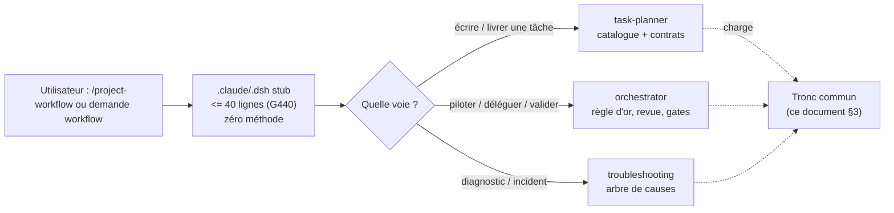
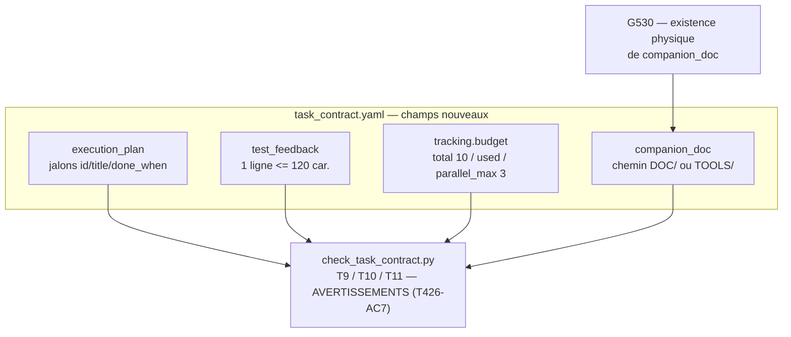

# TASK_NOTE T427 — Skill project-workflow & contrat étendu (note compagnon)

> 🧭 **Note compagnon du contrat T427** ([contrat](T427_WORKFLOW_AGENTS_CONTRAT_WORKFLOW_ET_FUSION_T426_20261110_v1.0.yaml)).
> Porte les schémas, graphiques et notes visuelles qui ne tiennent pas dans le YAML.
> Liée par le champ `companion_doc` → contrôle d'existence : `G530_check_contract_refs.py`.

---

## 1. Architecture du routeur de skill (AC1, décision D2 du 2026-11-12)



- **Stub** = routeur mince (≤ 50 lignes demandé, 40 pour passer G440) : front-matter + pointeur + question de routage. **Zéro duplication** du tronc (règle anti-dérive `check_skill_stubs.py`).
- **Canonique** = `TOOLS/AGENT_WORKFLOW/skills/project-workflow/SKILL.md` : tronc commun compact (≤ 1500 tokens) + renvois vers les 3 voies existantes.
- Les 3 voies restent des skills canoniques inchangées — pas de deuxième journal, pas de doublon de règles.

## 2. Contrat étendu — les 4 champs nouveaux (AC2, contrôles T9-T11)



**Définitions T9-T11** (dérivées de l'AC2 du contrat — signalées par le responsable faute de définition écrite préalable) :

| Règle | Exige | Infraction |
|---|---|---|
| **T9** | Dès C2 : `execution_plan` avec ≥ 1 jalon, chacun avec `title` et `done_when` non vides | Contrat sans jalons testables = plan creux (REX T426 : « critères 3 phrases génériques ») |
| **T10** | Chaque entrée `test_feedback` = **une** ligne ≤ 120 caractères, **sans code à chaud** | Sas d'essais pollué par des paragraphes ou commandes exécutables |
| **T11** | `tracking.budget` cohérent (0 ≤ used ≤ total, 1 ≤ parallel_max ≤ total) ; `companion_doc` = chemin de projet sans restes de gabarit | Budget auto-contradictoire ; compagnie non routable |

⚠️ **Mode progressif (T426-AC7)** : T9-T11 produisent des **AVERTISSEMENTS**, jamais d'erreur —
exit code inchangé pour les contrats antérieurs. Activation bloquante ultérieure seulement avec
un plan validé humainement.

## 3. Tronc commun du routeur (≤ 1500 tokens)

Contenu canonique, écrit une seule fois dans `TOOLS/AGENT_WORKFLOW/skills/project-workflow/SKILL.md` :

1. **Règle d'or** : aucune implémentation modifiante sans validation humaine de tâche + plan ; après GO, le lot roule sans arrêt au fil de l'eau.
2. **Sécurité machine** : liste fermée de blocage ; `Enable > SafeStop > StartStop` ; AU physique seul coupe brutalement ; pas de redémarrage auto après défaut.
3. **Sources** : standards `DOC/STDS/` (version `_vX.Y` la plus élevée), `AGENTS.md` pointeur, specs métier `AF_PartieN`.
4. **Preuves minimales** (CODE/ ou bundle) : bundle + diff bundle + `G200 --report` BLOQUANT ; fin de lot : `run_all_gates.py`. Jamais `Device.export` comme référence.
5. **Commits** : jamais sans validation humaine explicite ; jamais de push sur `main` sans rel relecture du diff.
6. **Routage des sorties** : table T279 ; pas de scratch à la racine.

## 4. Règle « 1 tâche = 1 dossier » (AC6)

```text
DOC/WFLOW/TASKS/T<ID>_<NOM>/
├─ T<ID>_<NOM>_CONTRAT_…_<DATE>_v1.0.yaml   ← le contrat (seul YAML actif)
├─ T<ID>_<NOM>_PLAN_<DATE>_v1.0.md          ← le plan (seul md de travail)
├─ PREUVES/<date>_SESSION_…/   ← sur validation
├─ ARCHIVES/                   ← originaux, revues intermédiaires
└─ CONTRACTS/                  ← sous-contrats délégués
```

Base minimale = **contrat + plan** ; extensions uniquement sur validation écrite. Écrite **une
seule fois** dans `WORKFLOW.md` (§ Emplacement des dossiers de tâche). Conditions de migration
(fusion T426) : ① zéro perte de contenu · ② liens entrants inventoriés · ③ parcours humain et
agent identiques · ④ pas de double saisie · ⑤ table ancien→nouveau **validée par l'exploitant
avant tout déplacement**.

**T427** : conforme (ce dossier). **T429** : conforme sur la base minimale (contrat présent,
PREUVES/ARCHIVES/CONTRACTS) mais **plan séparé absent** — verrou AGY01 actif : migration à
proposer **après** remise du lock, jamais en le contournant.

## 5. Plan d'activation des hooks (D3 — rédigé, NON activé)

> Décision du 2026-11-12 : le plan est rédigé, les hooks actifs restent inchangés. Aucun hook
> n'est activé sans GO dédié sur ce plan (T426-AC7 : activation bloquante après validation
> humaine et tests de faux positifs).

| Hook | Aujourd'hui | Changement proposé | Risque / limite | Garde-fou |
|---|---|---|---|---|
| `PreToolUse` | Bloque l'écriture CODE/ si règles non lues (vérifiées au transcript) | **Inchangé** | Aucun : ce lot n'ouvre ni CODE/ ni les specs de sécurité | n/a |
| `PostToolUse` | Signale liaison + liens doc à chaque édition ; REX : « trop lourd à chaque édition » | Alléger : signalement **regroupé** (fin de session ou ~5 éditions) au lieu de chaque édition | Bruit résiduel vs perte d'information | Compteur d'éditions par fichier ; message synthétique avec les chemins |
| `Stop` | Conclure un tour avec liaison rouge ou bundle périmé = bloqué ; REX : « blocage du Stop sur checkpoints WIP » | Non-bloquant : ① n'empêche PAS une conclusion qui déclare explicitement un checkpoint WIP ; ② affiche le rappel liaison/bundle et laisse conclure ; ③ reste bloquant hors WIP | Un tour peut se conclure avec une liaison rouge non signalée si le message est ignoré | Le rappel Stop nomme explicitement la liaison — l'humain voit la mention ; gate G200 reste BLOQUANT en fin de lot |

**Procédure d'activation (à exécuter uniquement sur GO dédié)** :
1. Mesurer les faux positifs sur 2 tâches pilotes (rejeu d'une session réelle : nombre de réveils Stop non pertinents).
2. Activer PostToolUse allégé d'abord, Stop non-bloquant ensuite — jamais tous d'un coup.
3. Comparer les configurations avant/après (diff `.claude/settings.json` + `TOOLS/AGENT_WORKFLOW/hooks/`).
4. Désactivation : inversion de ces étapes, sans suppression de données (les scripts restent, non référencés).
5. Journal : les modifications de configuration des hooks sont tracées dans la fiche T427 (avancement).

## 6. État des arbitrages (au 2026-11-12)

| Décision | État | Contenu |
|---|---|---|
| D1 ID survivant | ✅ tranchée | T427 |
| D2 skill | ✅ tranchée ce tour | **Créer** `project-workflow` (routeur mince + tronc) |
| D3 hooks | ✅ tranchée ce tour | Plan rédigé (§5), hooks inchangés jusqu'à GO dédié |
| D4 propriétaire | ✅ tranchée | CC01 unique |
| D5 document maître | ✅ tranchée ce tour | **Statu quo** : contrat YAML + plan MD compagnon (vérifiabilité mécanique T9-T11) |
